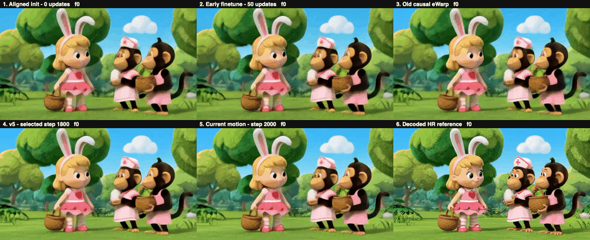

# Sol-H3 — 流式视频超分

2026-11-06 19:48（北京时间）：**[正式规格纠正与当前训练进度](results/h3_production_geometry_progress_20261106/README.md)**。新一轮 teacher 蒸馏**尚未启动正式训练（0步）**；旧384→768数据准备已停止。目标已纠正为 LR `[1,24,67,44,80]` → HR `[1,24,67,68,120]`，最终1920×1080、226帧、24fps。新包记录已完成的分辨率诊断、CPU审查及尚待完成的实际运行与HR质量守门；下方六项对比仍为旧尺寸结果。

2026-11-06：**[五版 H3 因果 upscaler 权重与加载说明](weights/h3_v5_20261106/README.md)**，对应零更新、50 步、旧 eWarp、v5 和 motion 的同片对比。权重通过 [GitHub Release](https://github.com/RedRoman/Tencent-streaming-sr/releases/tag/h3-v5-weights-20261106) 下载；保留原始 FP32 参数，并提供配置、原始/公开 SHA256 与 CPU 加载核验。

2026-11-06：**[六项同片对比与最新诊断](results/h3_v5_progress_20261106/README.md)** 已发布：用户指定动画的零更新改造、50步、旧 eWarp、v5、motion、HR 参考，以及原版双向 teacher 的双栏对照。**motion 两臂训练和评估已结束：指标小幅改善，主要视觉伪影未解决**；原始 latent eWarp 退步，未将其推荐为新交付版本。v5 仍固定为 [step1800 基线](versions/v5/README.md)。

[](results/h3_v5_progress_20261106/media/all_six_0086441.mp4)

**[完整六格 MP4](results/h3_v5_progress_20261106/media/all_six_0086441.mp4) · [四组双栏与诊断报告](results/h3_v5_progress_20261106/README.md)**。上排：零更新 / 50步 / 旧 eWarp；下排：v5 / motion / decoded HR 参考。本快照已发布选定对比视频，其余批量媒体与本地权重归档仍在后续交付范围。

2026-11-05 [固定 step1800 的完整16条test像素补测](results/h3_conv3d_test16_20261105/README.md)已完成：新增13条与原3条合并，每条120帧、24fps、5秒，未重训或重新选模。新Conv3d相对旧causal的平均PSNR为25.5670 vs 24.3314dB，LPIPS为0.131721 vs 0.200394（降低34.27%），像素时间差分MSE降低20.26%；16条均改善。原版双向teacher仍整体更好，既有latent eWarp退步8.96%的结论保留；测试集已复用，decoder仍非因果。结果含26段新增展示视频、逐片与分类指标、抽帧观察和完整审计证据。

2026-11-05 [原版因果 H3 Conv3d 互补训练](results/h3_conv3d_hybrid_20261105/README.md)已完成：attempt2独立跑满2000步，含step0的dev选模选择step1800。四例全120帧平均PSNR从旧causal eWarp的23.6710提升至24.9528dB，LPIPS从0.209778降至0.140644（-32.96%）；16条复用test的latent eWarp则由0.225486升至0.245695（+8.96%，退步）。原版teacher仍有更高像素PSNR；像素仅4固定例，test已复用。attempt1中断的83步另行归档且不计最终2000；默认小空间HF32流式一致性失败与独立HF32off通过分别保留。结果含训练曲线、六列5秒视频及完整证据。

2026-11-05 完成 [H3 CMN 互补训练](experiments/h3_cmn_hybrid_20261105/README.md)：融合原版 H3 teacher 蒸馏、HR latent/eWarp 与冻结 decoder 的图像 L1/LPIPS，新增 2000 步、dev 选择 step1800。四例完整 5 秒视频相较原 CMN 平均 PSNR +0.4261 dB、LPIPS −16.67%，但仍落后旧 causal eWarp 和原版 teacher；16 条 test latent eWarp 退步 2.16%。[最终指标、曲线和对比视频](results/h3_cmn_hybrid_20261105/README.md)。

2026-11-05 新增 [H3 CMN latent upscaler 实验](experiments/h3_cmn_upscaler_20261105/README.md)：约 106 万参数，从零训练 10,000 步，继续使用原 H3 decoder；36 项因果检查和 19 项独立重载检查通过。当前画质仍低于原 H3 upscaler，完整指标、失败样例与 5 秒视频见[结果目录](results/h3_cmn_upscaler_20261105/README.md)。这是 UltraFlash 思路的 H3 适配原型，不是完整论文复现或端到端流式验证。

2026-11-04 新增独立研究快照：[Open-H3 refiner 的 Self Forcing + DMD 单步实验](experiments/h3_refiner_self_forcing_20261104/README.md)、[因果化与人物幻觉消融分析](experiments/h3_refiner_self_forcing_20261104/ANALYSIS.md)、[结果与视频](results/h3_refiner_self_forcing_20261104/README.md)。该实验使用 H3 自身作 refiner，训练链路已跑通但画质未达标；与下方原 Sol-H3 像素域 refiner 结果分开记录。

低分辨率流式 H3 + 高清 refiner。H3 在 448×256 生成，一个 10.24M 的像素域 refiner
放大 3 倍到 1344×768；H3 每隔 30 帧额外产出一个 HR latent 作为细节参考，
refiner 直接消费该 latent（不解码）。

| | PSNR | LPIPS↓ | 比 bicubic 好 | flicker |
|---|---|---|---|---|
| bicubic | 26.005 | 0.2852 | — | 0.0123 |
| v1 | 26.577 | 0.2052 | 28.1% | 0.0122 |
| **v2（交付版）** | **27.320** | **0.1714** | **39.9%** | 0.0114 |

端到端流式：块周期 710 ms（预算 708 ms），漂移 −0.01 s，**零欠载**，首帧 1.30 s。

## 从哪开始

- **接手的人先读 [`HANDOFF.md`](HANDOFF.md)** —— 环境、跑法、踩过的坑、没做完的事
- 完整数据与推理过程见 [`REPORT.md`](REPORT.md)
- 权重与对比视频在 [Releases](../../releases)

## 目录

```
code/      全部源码（127 个 .py + 启动脚本）
logs/      训练与诊断日志
results/   实验元数据（config / metrics / summary，196 个 run）
```

## 注意

代码跑在 ModelArts 30778（昇腾 910B3），**每个 shell 必须先 `source solh3_env.sh`**，
否则所有算子报 CANN 561103。脚本末尾的 `free(): invalid pointer` / SIGABRT
是 CPython 退出噪声，不是失败。详见 HANDOFF 第 3 节。
