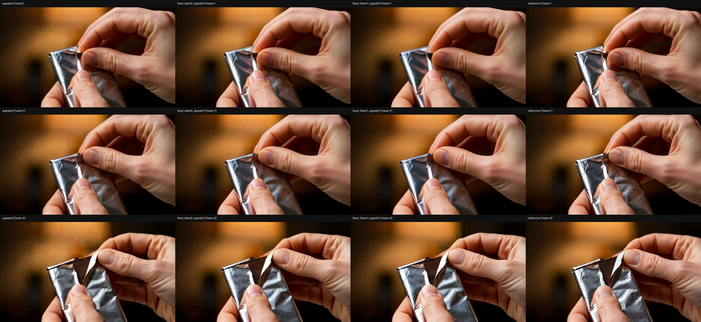
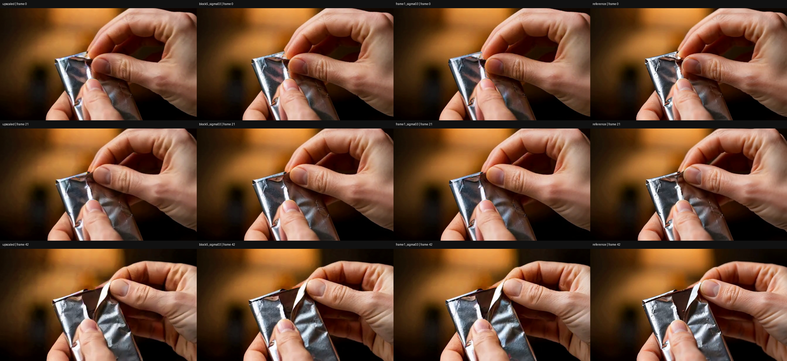

# H3 refiner 时间因果化：推理结果

本轮将发布的 H3 diffusion refiner 分别用于 **5 个 latent 帧一块的块因果**与 **1 个 latent 帧一块的逐 latent 帧因果**推理。冻结发布权重，不加载之前训练的 generator adapter，不做优化或新的 DMD 训练。[实现与复现入口](../../experiments/h3_causal_refiner_20261104/README.md)。

仅用一个留出片段、一个随机种子。输入 `[24,13,24,42]`，解码为 43 帧、672×384、24 fps。文本和全长静音编码固定。每块仅去噪一步，历史来自自身已生成输出；静态条件 query 不读视频，视频 query 只能读取静态条件、过去块和当前块。block5 块内双向，frame1 帧内空间双向。

## 数值检查

| 检查 | 最大绝对差 | 结果 |
| --- | ---: | --- |
| 相同 13 帧长度，扰动未来，第一个 5 帧块输出 | 0 | 通过 |
| 相同 13 帧长度，扰动未来，第一个 latent 帧输出 | 0 | 通过 |
| dense 对照的前 5 帧对未来扰动响应 | 3.241877 | 对照有效 |
| 变长前缀 5 对完整 13 的共同前 5 帧 | 0.164967 | **失败** |
| 变长单帧 rollout 首帧对完整 13 的首帧 | 0.086939 | **失败** |
| 固定 13 帧、未来补零，第一个 5 帧块 | 0 | 通过 |
| 固定 13 帧、未来补零，第一个 latent 帧 | 0 | 通过 |
| 固定 13 帧、frame1 rollout 首帧重放 | 0 | 通过 |

阈值为 `1e-4`。原始 [variable_prefix/summary.json](variable_prefix/summary.json) 保留 `passed=false`，其命令写完证据后以断言失败退出；[fixed_shape/summary.json](fixed_shape/summary.json) 是独立的成功对照，没有删除失败项或放宽阈值。两个旧推理输出的重现检查最大绝对差均为 0，位置编码共同前缀也完全一致。

变长执行的首次**采样到的**分歧在第一层 attention 输出、输出投影之前，BF16 最大绝对差 `0.001953125`。此前采样 Q/K/V 等一致，但只采样共享 token 行，不能据此证明所有隐藏值一致，也不能确定某个算子是根因。

固定窗口版本只将实际前缀复制到 13 帧零张量里，不填入真实未来视频。未来槽不能被过去视频及静态条件 query 读取。该方案验证了当前固定窗口的受控执行路径，尚未实现 KV cache 或无限长流式推理。

## 视频与观察

每个四列对照从左到右为 **upscaled 输入 → block5 → frame1 → reference**，两种 refiner 均为 `sigma=0.3`。PNG 为首、中、尾帧。所检查帧均保留手与银箔，没有观察到旧实验新增的人物；这不是逐帧动态审阅，也不足以证明一般性的内容保真或画质提升。

| 执行方式 | 四列视频 | 单独输出 |
| --- | --- | --- |
| 固定 13 帧、未来补零 | [对照视频](fixed_shape/comparison.h264.mp4) | [块因果](fixed_shape/fixed_block5_sigma03.h264.mp4) · [逐 latent 帧因果](fixed_shape/fixed_frame1_sigma03.h264.mp4) |
| 变长前缀（数值一致性未通过） | [对照视频](variable_prefix/comparison.h264.mp4) | [块因果](variable_prefix/block5_sigma03.h264.mp4) · [逐 latent 帧因果](variable_prefix/frame1_sigma03.h264.mp4) |

| sigma=0.3 rollout | 模型调用次数 | 时间（不含解码） |
| --- | ---: | ---: |
| 固定窗口 block5 | 3 | 10.247 秒 |
| 固定窗口 frame1 | 13 | 46.090 秒 |
| 变长前缀 block5 | 3 | 8.966 秒 |
| 变长前缀 frame1 | 13 | 40.389 秒 |

时间来自本次双 NPU 运行，非重复基准，未测试 2K。降低 sigma 同时改变输入保留比例、噪声幅度、模型时间与步长，不能将没有新增人物归因于单向注意力；旧高 sigma 的因果 rollout 仍曾出现新增人物。

## 结论边界

- 这里只检验固定 upscaled 输入与静态条件下，refiner 的视频 latent 时间因果性；上游 VAE、latent upscaler 仍非因果，没有测试未来音频扰动，因此整条 pipeline 不能称为严格流式因果。
- 扰动检查覆盖首个块边界、一个片段与一个种子；不能外推到全部输入和边界。
- 本轮不证明因果化后模型已适配该分布或 Self Forcing DMD 已收敛。后续训练需要在相同因果执行方式下进行，再扩大留出集评估。
- Reference 仅用于展示；与低分辨率分支的 VAE 编码上下文不同，本页不据此报告像素级恢复指标。
- 发布代码、脱敏报告、抽帧图和六段 H.264 视频；不含模型权重、latent 缓存或原始数据集。视频经过有损转码，数值检查在转码之前的 latent 上完成。
