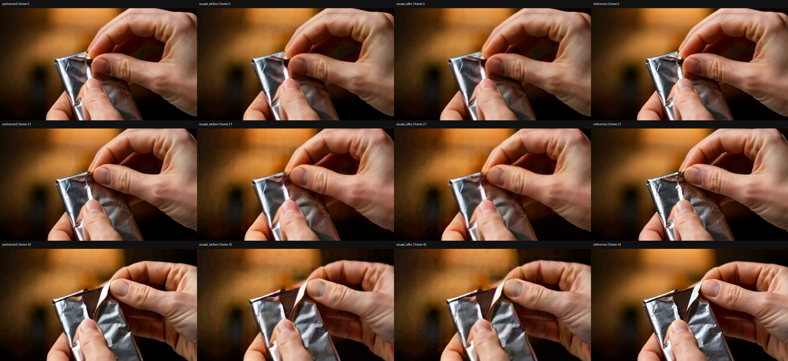
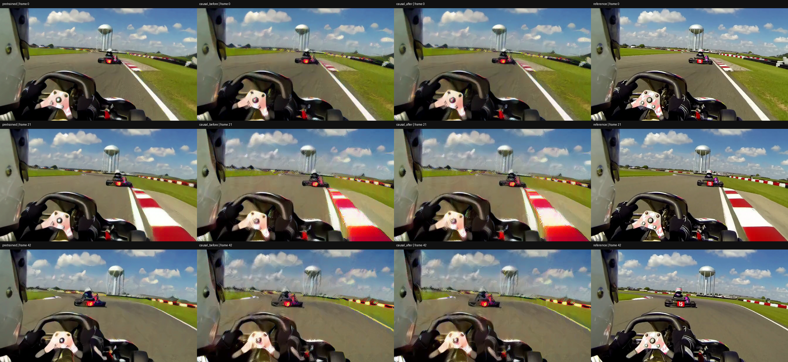

# 独立因果 upscaler：先评估，再微调

本轮只处理 Open-H3 latent upscaler。**不加载 H3 diffusion refiner，不使用 DMD，不训练 VAE。** 输入是固定的 LR latent，输出是 2× 空间分辨率的 HR latent；同一冻结 VAE 仅负责解码评估。[结构、代码与复现入口](../../experiments/h3_causal_upscaler_20261104/README.md)。

本轮结论是：**因果化与分块执行已验证，50 步微调降低了 latent 误差，但画质尚未恢复。** 开发留出片段 PSNR 只提升约 `0.018 dB`，仍比原版非因果模型低约 `3.357 dB`。

## 冻结改造评估

原模型的时间卷积与跨时间 GroupNorm 都会读取未来。改造将时间卷积改成只向左补零，并将 GroupNorm 改成每个 latent 帧独立统计，保持 `D(U(N(z)))` 和只放大空间的 resize 约定。

- `causal_shifted`：直接保留原卷积系数，改为左 padding。原来的中心系数会对应到过去时间，因此这并非等价转换。本次出现明显棋盘纹和颜色失真，不能直接使用。
- `causal_aligned`：保留原来的过去／当前位置系数，丢弃未来系数，新增更早的时间位置置零。例如三位置卷积从 `[过去, 当前, 未来]` 变为 `[0, 过去, 当前]`。原相对位置得到保留，但仍损失预训练的未来信息，且归一化改变。

两个训练片段均表明 aligned 明显优于 shifted；后续固定从 aligned 初始化微调。开发留出样本的冻结 PSNR 为原版 **28.804 dB**、aligned **25.429 dB**、shifted **5.687 dB**。因果结构正确与画质可用是两个不同判断。

## 因果性和缓存检查

冻结阶段加载完整发布模型 **345,280,216** 个参数，FP32 计算 dtype；对两种初始化在开发留出片段的 cut 1/5/10 做未来扰动、前缀一致性，以及 `[5,5,3]`、13 个单帧、`[2,3,1,7]` 三种缓存分块和 reset 检查，最大绝对差全部为 **0**。原非因果阳性对照的未来扰动响应为 **3.299317**。还检查索引 4（从 0 开始）的 latent 帧输出的一个标量目标：其对未来输入的梯度为 0、对当前输入的梯度非零；这不是完整 Jacobian 检查。

微调后通过独立新模型重载，三个片段的重载差异均为 **0**；三个片段各自 3 个 future、3 个 prefix、3 个 chunk 检查合计 **27 项**，最大绝对差均为 **0**。对应证据见 [冻结报告](frozen/summary.json) 与 [微调报告](finetune50/summary.json)。数值阈值固定为 `1e-4`，没有事后放宽。

每个时间卷积缓存其实际输入后缀，共 62 层；本例缓存约 **181.17 MiB**。这是实际的分层缓存，不重新计算全部历史。卷积结构最长感受野为 149 个 latent 帧，但本轮只测了 13 帧，未验证长流稳态画质或 2K 性能。上游 VAE 仍非因果，以上结论只针对固定 latent 输入下的 upscaler。

## 微调配置和结果

先完成冻结基线与解码评估，再运行固定 **50 步**微调；两个训练片段轮换，每个 25 次更新，学习率 `1e-6`，AdamW，weight decay `0.01`，目标为 normalized-latent MSE 加 `0.1 × 时间差分 MSE`。所有 upscaler 参数可训练，eval 模式关闭 dropout。每一步记录有限非零全局梯度、322 个参数张量与损失连通，以及抽样参数值发生更新。开发留出片段不参与参数更新、步数调整或 checkpoint 选择；但它在此前开发过程中已被查看，不能作为盲测集声称泛化。

训练更新耗时约 **30.80 秒**，含初始化、保存、重载和检查的脚本总耗时约 **66.11 秒**；峰值已分配 NPU 内存约 **5.27 GiB**。这些是本例运行值，不是重复基准。

像素指标相对**同一 VAE 解码的配对 HR reference**计算，使用压缩前 uint8 RGB，43 帧、672×384、24 fps。越高越好：

| 片段 | 划分 | 插值 PSNR | 原版非因果 | 因果微调前 | 因果微调后 |
| --- | --- | ---: | ---: | ---: | ---: |
| VIDGEN5S_0336361 | train | 15.734 | 20.930 | 18.735 | 18.959 |
| VIDGEN5S_0515402 | train | 16.233 | 22.770 | 19.657 | 19.663 |
| VIDGEN5S_0380588 | holdout | 18.192 | 28.804 | 25.429 | 25.447 |

开发留出片段 PSNR 变化为 **+0.018 dB**。

latent MSE 越低越好：

| 片段 | 原版非因果 | 因果 shifted | 因果 aligned 微调前 | 因果微调后 |
| --- | ---: | ---: | ---: | ---: |
| VIDGEN5S_0336361 | 0.108662 | 66.573227 | 0.397857 | 0.212249 |
| VIDGEN5S_0515402 | 0.144848 | 66.191971 | 0.431820 | 0.232776 |
| VIDGEN5S_0380588 | 0.071147 | 57.387928 | 0.397889 | 0.297331 |

不能混淆 latent 与像素指标：冻结 aligned 的留出 latent MSE 略差于插值，但 decoded PSNR 高于插值。微调后的 latent 误差下降并不自动证明感知质量改善；要结合下面画面以及 [完整像素指标](finetune50/pixel_metrics.json)，其中另有时间差分误差和源 RGB 次要对照。

## 视频与可视检查

初始化四列：原版非因果 → causal_shifted → causal_aligned → reference。

微调四列：原版非因果 → 因果微调前 → 因果微调后 → reference。

| 片段 | 冻结改造 | 微调 |
| --- | --- | --- |
| VIDGEN5S_0336361 | [初始化对照](frozen/VIDGEN5S_0336361/comparison.h264.mp4) | [微调前后对照](finetune50/VIDGEN5S_0336361/comparison.h264.mp4) · [微调后单独输出](finetune50/VIDGEN5S_0336361/causal_after.h264.mp4) |
| VIDGEN5S_0515402 | [初始化对照](frozen/VIDGEN5S_0515402/comparison.h264.mp4) | [微调前后对照](finetune50/VIDGEN5S_0515402/comparison.h264.mp4) · [微调后单独输出](finetune50/VIDGEN5S_0515402/causal_after.h264.mp4) |
| VIDGEN5S_0380588 | [初始化对照](frozen/VIDGEN5S_0380588/comparison.h264.mp4) | [微调前后对照](finetune50/VIDGEN5S_0380588/comparison.h264.mp4) · [微调后单独输出](finetune50/VIDGEN5S_0380588/causal_after.h264.mp4) |

检查首、中、尾帧时，微调前后画面变化较小；运动片段的车体、水塔轮廓以及做饭片段的手臂附近仍可见重影和纹理失真，尚未明显恢复原版水平。PNG 是首、中、尾帧；相关视觉结论限于这些抽帧，未作完整动态或感知评分。所有视频为有损 H.264 转码，数值指标在转码前计算。

## 保存与限制

- 完整模型和优化器保存在实验存储中，GitHub 仅发布代码、脱敏报告、训练日志、抽帧图和九段视频，不包含大体积权重或原始数据集。
- checkpoint 保存 `adapter_config`。加载权重后必须重新安装 causal adapter，**不能再次执行 aligned 权重移位**。独立重载已验证。优化器虽已保存，本驱动未实现 resume。
- 当前只有两个训练片段和一个开发留出片段，不能证明泛化或充分收敛；训练数据来自源视频 VAE 编码，不能外推到生成模型 draft latent 的分布。
- VAE 编码与解码仍非因果；把这个 upscaler 与 causal refiner 组合，也不能直接声称整条像素 pipeline 已严格流式化。
