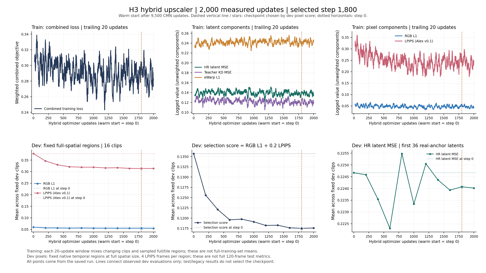
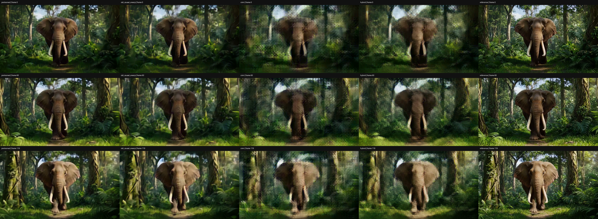
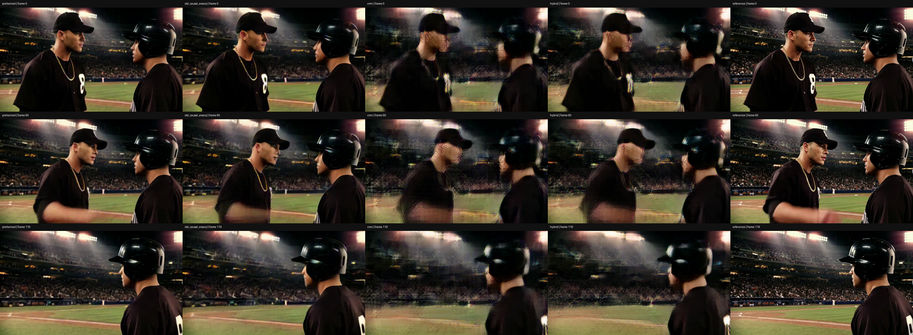
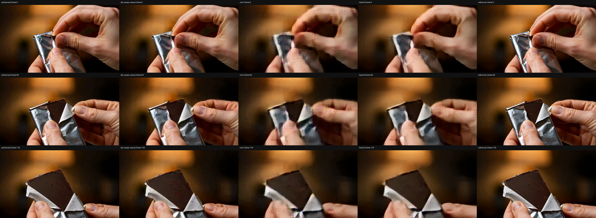

# H3 CMN + Method2 互补训练：完成结果

已完成 **2000 次追加更新**，从原 CMN step9500 初始化，网络仍为 **1,061,336 参数**。Dev 在 step0/200/…/2000 中选择 **step 1800**；固定 dev 区域的 RGB L1 +0.2 LPIPS 从 **0.135716** 变为 **0.117503**。训练与 dev 验证耗时 **100.19 分钟**，不含初始化审计、最后独立评估与视频转码。[代码与复现](../../experiments/h3_cmn_hybrid_20261105/README.md)。

相对原 CMN，四条固定视频全120帧的均值：PSNR 从 **19.8782 → 20.3043 dB**（提高 0.4261 dB），LPIPS 从 **0.378020 → 0.314994**（降低 0.063026）。16 条复用 test 的 latent MSE 差值为 **-0.002132**，eWarp L1 差值为 **+0.005159**，均为 hybrid 减原 CMN，越低越好。这里只报告对应范围内的结果，不能把像素改善等同于所有指标、完整 test 或真实生成视频都改善。

## 实验配置

保留 CMN 的轻量因果结构和 HR latent/eWarp 监督，加入原版 H3 teacher latent 蒸馏，以及通过冻结 H3 decoder 回传的 RGB L1 / LPIPS。损失为 `HR latent MSE +0.25 teacher MSE +0.1 eWarp +1 RGB L1 +0.2 LPIPS(Alex v0.1)`。Teacher 只为128train/16dev提供训练标签；像素目标是 HR reference latent 经冻结 decoder 解码，未使用 teacher 像素作为目标。

FP32、batch1、全新 AdamW、lr3e-5→3e-6、warmup100、clip1、seed20261105。每4步中1步用完整空间的原生时间块，3步用原生空间 tile 的内部区域；L1覆盖所选真实帧，LPIPS每区4帧。所有可选时间块合计覆盖90/120真实RGB位置，避开原 decoder 跨窗混合位置；它不是完整120帧训练损失，也不是无偏估计。37个latent中的前36进入MSE/KD，35对进入eWarp；最后padding-only latent保留为decoder上下文，允许接收像素梯度。最终像素评估则覆盖全部120帧，另列prefix102/tail18。

只训练 latent upscaler；没有训练 decoder、refiner、DMD 或 Self Forcing。原 H3 decoder 仍非因果。流式检查仅针对固定 latent 输入上的 upscaler，不能证明从源 RGB 到输出 RGB 的零前视。128train /16dev /16test +3legacy 与前轮相同，源文件SHA去重不等于语义近重复去重；test已被前轮查看，**不是新盲测**。这是单条互补配方实验，没有新增同预算的 KD-only、pixel-only 消融，不能分离各损失项贡献。

## Latent 指标

每段等权平均，MSE/eWarp L1 越低越好；原 CMN、旧345M因果eWarp和原版345M teacher来自相同pair与已绑定SHA的历史latent结果。旧 causal eWarp **不是 Method2 的15M学生**，本次未直接重跑 Method2，也未做等参数/等算力比较。

| 模型 | test16 MSE | test16 eWarp | legacy3 MSE | legacy3 eWarp |
| --- | ---: | ---: | ---: | ---: |
| CMN hybrid | 0.211997 | 0.243794 | 0.216287 | 0.243522 |
| 原 CMN | 0.214129 | 0.238635 | 0.217018 | 0.238335 |
| 旧 causal eWarp | 0.094213 | 0.225486 | 0.095610 | 0.229080 |
| 原版 teacher | 0.075321 | 0.279686 | 0.094232 | 0.281689 |

## 四条固定视频的像素指标与输出

选片为test animal/daily/sport各按ID取第一条，加legacy固定例；没有按本轮结果挑选。以下均为**仅这4条**、每条全部120帧、片段等权均值。PSNR取每段PSNR的平均，不是合并MSE后的PSNR。指标在压缩前的uint8 RGB上计算；主目标为同一冻结VAE解码的HR latent，源RGB次要对照见JSON。LPIPS为Alex v0.1逐帧平均。PSNR越高越好，LPIPS/时间差分MSE越低越好。

| 模型 | PSNR dB | LPIPS | 时间差分MSE |
| --- | ---: | ---: | ---: |
| pretrained | 25.7815 | 0.141066 | 0.001988 |
| old_causal_ewarp | 23.6710 | 0.209778 | 0.002712 |
| cmn | 19.8782 | 0.378020 | 0.003993 |
| hybrid | 20.3043 | 0.314994 | 0.003571 |

每例单元格为 `PSNR / LPIPS`：

| 片段 | pretrained | old_causal_ewarp | cmn | hybrid |
| --- | ---: | ---: | ---: | ---: |
| VIDGEN5S_0128747 | 21.659 / 0.2485 | 20.501 / 0.3243 | 18.285 / 0.4808 | 18.625 / 0.4056 |
| VIDGEN5S_0086441 | 25.482 / 0.1130 | 23.067 / 0.1853 | 18.378 / 0.4081 | 18.847 / 0.3352 |
| VIDGEN5S_0829322 | 25.874 / 0.1471 | 23.552 / 0.2347 | 19.873 / 0.4140 | 20.239 / 0.3451 |
| VIDGEN5S_0380588 | 30.112 / 0.0556 | 27.564 / 0.0949 | 22.977 / 0.2091 | 23.506 / 0.1741 |

五列顺序固定为 **原版 teacher → 旧 causal eWarp → 原 CMN → hybrid → decoded HR reference**。单列分辨率672×384，本轮不是2K训练。8段发布H.264视频均为120帧、24fps、5秒，已全片解码复核；原始评估的24段MP4也完成全片技术解码检查。

| 片段 | 对照 | hybrid单列 |
| --- | --- | --- |
| VIDGEN5S_0128747 | [5秒对照](VIDGEN5S_0128747/comparison.h264.mp4) | [hybrid输出](VIDGEN5S_0128747/hybrid.h264.mp4) |
| VIDGEN5S_0086441 | [5秒对照](VIDGEN5S_0086441/comparison.h264.mp4) | [hybrid输出](VIDGEN5S_0086441/hybrid.h264.mp4) |
| VIDGEN5S_0829322 | [5秒对照](VIDGEN5S_0829322/comparison.h264.mp4) | [hybrid输出](VIDGEN5S_0829322/hybrid.h264.mp4) |
| VIDGEN5S_0380588 | [5秒对照](VIDGEN5S_0380588/comparison.h264.mp4) | [hybrid输出](VIDGEN5S_0380588/hybrid.h264.mp4) |

对四条 comparison.png 中第0、60、119帧的检查显示：hybrid 相对原 CMN 减轻了部分边缘涂抹和振铃，但细节缺失、双重轮廓仍明显；动画人物面部与兔耳、大象鼻子和象牙、棒球人物面部及头盔边缘仍有模糊或重影，手指与包装细边缘仍不及旧 causal eWarp 和原版 teacher。不能据此声称重影已解决。这里的主观判断仅覆盖这些抽帧，不代表完整运动质量评测；数值改善也不意味着已经达到现有大模型 upscaler 的质量。

## 验证与文件来源

2000条连续更新日志；包含step0的固定dev选模；冻结decoder/LPIPS未变且未累积梯度；12项原生decoder区域一致性检查；19条独立checkpoint重载；4条视频共36项未来扰动、前缀与分块状态检查均通过。每项误差与阈值见 [evaluation/summary.json](evaluation/summary.json)。逐latent upscaler计时不包括VAE、I/O和完整pipeline，不能当作端到端实时速度。

[训练配置与合同](cmn_kd_pixel_steps2000/contract.json)、[训练日志](logs/train.log)、[原始结果的公开脱敏副本](evaluation/summary.json)、[H.264全片审计](evaluation/h264_decode_audit.json)、[原始/公开SHA映射](source_fingerprints.json)与[发布字节manifest](snapshot_manifest.json)可相互核对。脱敏后的JSON字节SHA与远端原始JSON不同；其中嵌入的plan/source/checkpoint等SHA仍保留原始含义，不能拿公开JSON的SHA替换训练合同。公开源码SHA与执行源码SHA映射保留在[代码source_fingerprints](../../experiments/h3_cmn_hybrid_20261105/source_fingerprints.json)。媒体转换关系另见[media_transformations.json](media_transformations.json)。本地已核验best checkpoint SHA，但不发布权重、teacher/latent/source缓存或原始源视频。历史源文件/模型权重只核对已记录fingerprint，不声称重新下载全部tensor重新计算。
