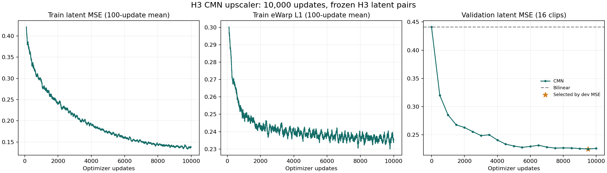
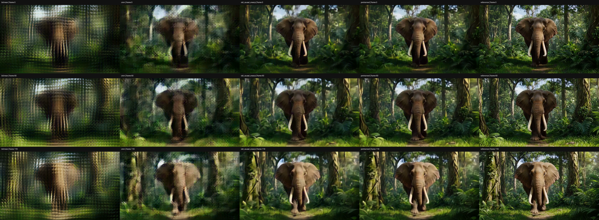
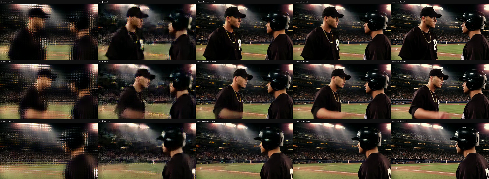
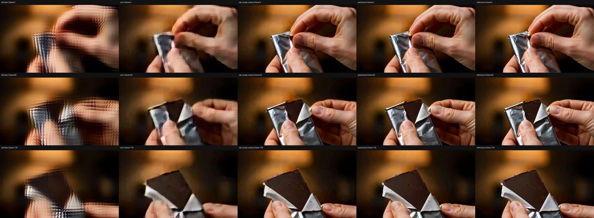

# H3 CMN upscaler：单主run结果

新建CMN-inspired latent upscaler，共 **1,061,336 参数**；已完成 **10000 次更新**，dev选择 step **9500**，最低dev latent MSE **0.224665**。训练用时 **5.98 分钟**，相当于128条训练片段约78次遍历，不能与论文大数据训练规模等同。数值表由完成的原始summary生成。[代码与复现](../../experiments/h3_cmn_upscaler_20261105/README.md)。

**工程与因果性已跑通，但当前权重画质不足以替代现有H3 upscaler。** 16条复用test上的latent MSE从bilinear的0.438584降至CMN的0.214129，但仍高于旧因果eWarp模型的0.094213。训练误差继续下降、后期dev改善趋缓，不能将增加同批数据的更新数当作保证画质提升。此对照没有分离参数容量、预训练、数据规模与优化配方的影响，不能据此判定CMN方法本身失败。

本轮只有 MSE+0.1×eWarp 主run，网络随机初始化加zero-head/bilinear base，继续使用冻结的既有H3 decoder，没有decoder/refiner/DMD训练。复用旧128/16/16+3划分和同一源plan SHA，retained test不是新的盲测。旧Conv3d结果是参考，架构、参数量、初始化和训练步数均有差异，不能单独归因为CMN或损失项。

## 固定划分latent评估

每个split内按片段等权平均，MSE越低越好；旧baseline来自相同pair与已冻结的前轮结果。

| 划分 | bilinear | cmn | pretrained | long_temporal | long_ewarp |
| --- | ---: | ---: | ---: | ---: | ---: |
| test | 0.438584 | 0.214129 | 0.075321 | 0.091238 | 0.094213 |
| legacy | 0.469317 | 0.217018 | 0.094232 | 0.093041 | 0.095610 |

## 四条固定展示片段

test animal/daily/sport各按ID取第一条，加旧legacy holdout；不是按分数或画面效果挑选。五列为latent双线性插值 → CMN → 旧因果eWarp → 原版非因果 → decoded HR reference。目标尺寸672×384，不是2K训练。下列八段H.264视频已通过独立全片解码，均为120帧、24fps、5秒，见[h264_decode_audit.json](evaluation/h264_decode_audit.json)。全片技术解码检查不等于完整运动质量主观评测。

| 片段 | 对照 | CMN单列 |
| --- | --- | --- |
| VIDGEN5S_0128747 | [5秒对照](VIDGEN5S_0128747/comparison.h264.mp4) | [CMN输出](VIDGEN5S_0128747/cmn.h264.mp4) |
| VIDGEN5S_0086441 | [5秒对照](VIDGEN5S_0086441/comparison.h264.mp4) | [CMN输出](VIDGEN5S_0086441/cmn.h264.mp4) |
| VIDGEN5S_0829322 | [5秒对照](VIDGEN5S_0829322/comparison.h264.mp4) | [CMN输出](VIDGEN5S_0829322/cmn.h264.mp4) |
| VIDGEN5S_0380588 | [5秒对照](VIDGEN5S_0380588/comparison.h264.mp4) | [CMN输出](VIDGEN5S_0380588/cmn.h264.mp4) |

四条展示片段相对decoded HR reference的PSNR（压缩前RGB），不能作为完整16-test像素指标；源RGB次要对照在evaluation JSON中。

| 片段 | bilinear | cmn | old_causal_ewarp | pretrained |
| --- | ---: | ---: | ---: | ---: |
| VIDGEN5S_0128747 | 16.300 | 18.285 | 20.501 | 21.659 |
| VIDGEN5S_0086441 | 14.678 | 18.378 | 23.067 | 25.482 |
| VIDGEN5S_0829322 | 17.445 | 19.873 | 23.552 | 25.874 |
| VIDGEN5S_0380588 | 18.392 | 22.977 | 27.564 | 30.112 |

对四条展示视频第0、60、119帧的图像检查显示：CMN减少了latent插值的周期网格伪影，但大象轮廓、动画/棒球人物面部、手指和包装边缘仍有重影、边缘扭曲或细节丢失。旧因果upscaler整体更清晰。上述判断仅覆盖这些抽帧，不声称完成主观运动评测或证明泛化胜出。

## 验证和范围

四条视频共 **36 项**CMN因果/流式检查通过，独立checkpoint reload覆盖 **19 条test/legacy**。原始每项误差、阈值与流式时延记录见 [evaluation/summary.json](evaluation/summary.json)；上采样器逐latent测时不包括VAE解码、I/O或完整pipeline，不等于端到端实时速度。这里未训练CMN decoder，原H3 decoder仍非因果。

120真实源帧经原VAE内部补16到136→37latent→解码124裁尾4→120帧；loss仅前36真实锚点与35有效warp对，最后padding-only latent仍作为旧非因果decoder上下文。光流、权重和所有latent/source视频缓存未发布。

JSON/JSONL已有的plan/checkpoint/source SHA保留原始run含义；公开脱敏会改变文件字节。原始/公开文件SHA对应见 [source_fingerprints.json](source_fingerprints.json)，公开code+results自身校验见 [snapshot_manifest.json](snapshot_manifest.json)，不含manifest自身。对未下载的checkpoint/tensor只保留来源哈希，不声称重新计算。README修改后应重新生成manifest。
