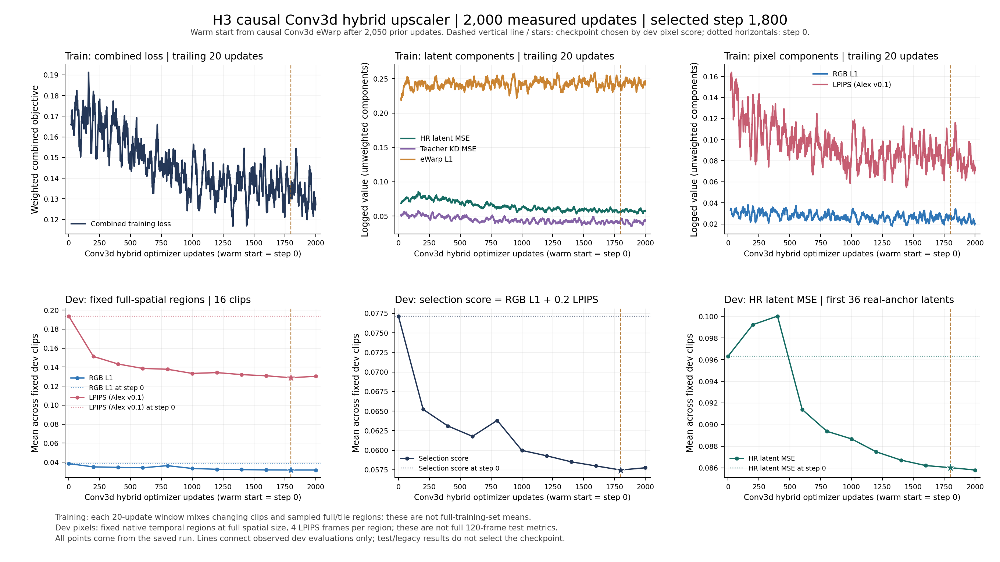
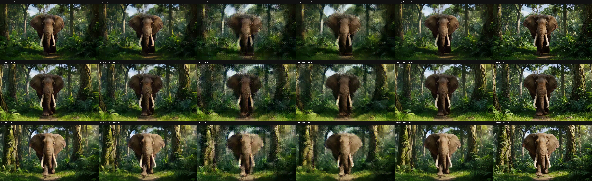
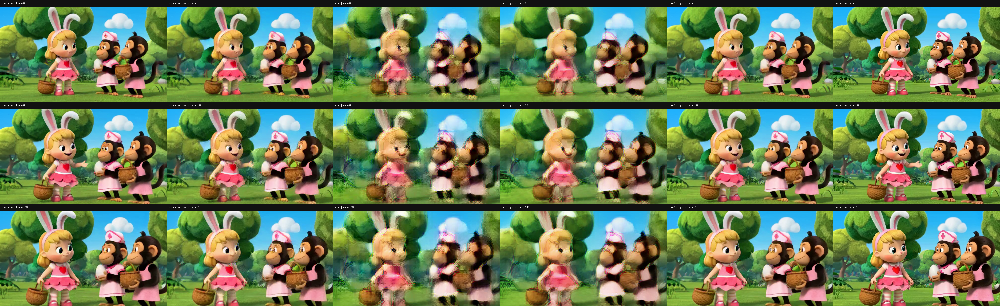
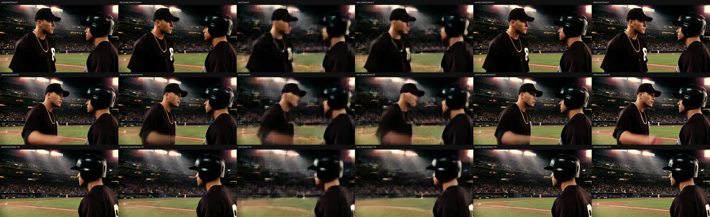
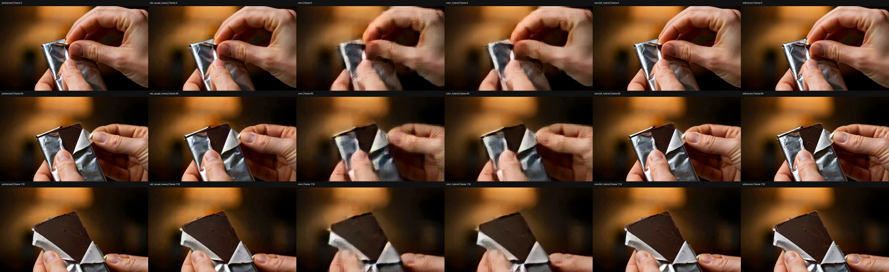

# 原版 H3 causal Conv3d：互补训练最终结果

**Attempt2已完整完成2000次追加更新**，沿用345,280,216参数的原版因果Conv3d，从旧causal eWarp权重重新起跑。Dev在step0/200/…/2000中选中 **step1800**；固定dev区域的RGB L1+0.2LPIPS由 **0.077134 → 0.057473**。本次训练含dev验证耗时 **144.57分钟**，不含初始化、最后评估和视频转码。[源码、复现与精度说明](../../experiments/h3_conv3d_hybrid_20261105/README.md)。

四条固定视频全120帧均值，与同架构旧causal eWarp相比：PSNR **23.6710 → 24.9528dB**（差值+1.2818dB）；LPIPS **0.209778 → 0.140644**（差值-0.069134）。作为另一个参考，小CMN hybrid为 **20.3043dB / 0.314994**，原版teacher为 **25.7815dB / 0.141066**。PSNR越高越好、LPIPS越低越好，不把单项提升写成全面胜出。

16条复用test的latent MSE相对旧causal eWarp差值为 **-0.011413**，eWarp L1为 **+0.020209**，均为新模型减旧模型、越低越好。像素结果仅覆盖固定4例，不能冒充完整16-test或真实生成视频的质量结论。

## 中断与重新开始

Attempt1曾写入83条更新后退出，shell退出码143支持SIGTERM判断，发起者未知；未见Python traceback，未找到OOM证据。当时尚未保存带optimizer/RNG的latest checkpoint，只有step0权重，不能恢复第83步训练状态。原run及日志按原字节归档，原始SHA与合同保留。

Attempt2使用相同冻结源码、配置和初始权重从0重新训练，**最终2000步不包含失败尝试的83步，也未拼接日志**。本次2000条steps连续覆盖1…2000；失败83条另存于[归档](failures/attempt1_terminated_step83/interruption.json)。[attempt_history.json](attempt_history.json)与两套独立日志保留实际过程，不将此次重跑称为从83步resume。上述训练时长是成功attempt2的时长，未将失败尝试耗时混入。

## 训练内容与适用范围

保持原345M网络、aligned-past时间卷积、逐帧GroupNorm、空间通路与latent N→U→D约定；已经对齐的权重原样加载，未再次移核。只训练upscaler，原H3 decoder与LPIPS冻结。目标为：`HR latent MSE +0.25 teacher latent MSE +0.1 eWarp L1 +1 RGB L1 +0.2 LPIPS(Alex v0.1)`。Teacher是原版双向upscaler，仅缓存train/dev标签；像素target是冻结decoder解码的HR reference latent，不是teacher像素。

数据保持128train/16dev/16test+3legacy，LR由HR源RGB严格2×area下采样后编码，不是真实低清生成器输出。每段5秒、120帧、24fps，目标672×384，本轮不是2K训练。源文件SHA去重不等于语义近重复去重；所有test/legacy此前已被查看，**不是新的盲测**。

新增2000步、batch1、fresh AdamW、lr3e-5→3e-6、warmup100、weight decay0.01、clip1、seed20261105。参数/输入为float32存储，训练保持conv HF32=true、matmul HF32=false，并在合同中记录；这不等于内部卷积使用完整FP32尾数。真实37latent训练检查与小空间163latent严格数学诊断是不同范围。

每4次更新有1次完整空间原生时间块、3次原生tile内部区域。像素窗口为7latent/stride5，排除跨窗混合与合成尾帧后可采90/120真实RGB位置；L1用区域内全部有效帧，LPIPS用4帧。这是采样像素目标，不是全视频loss或无偏估计。前36latent进入MSE/KD，35对进入eWarp；最后padding-only latent保留decoder上下文并可接收像素梯度。最终评估覆盖全部120帧，另报prefix102/tail18。

没有DMD、Self Forcing、diffusion refiner或VAE更新。不同学生容量、预训练历史和训练成本不同；没有新做等预算KD-only/pixel-only消融，不能分离每项loss的贡献。旧causal eWarp不是Method2的15M学生；本轮没有直接重跑Method2。

## Latent指标

每段等权平均；相同pair与metric定义。历史模型的latent指标从SHA绑定的已完成结果读取；新增模型由最佳checkpoint独立重载计算。

| 模型 | test16 MSE | test16 eWarp | legacy3 MSE | legacy3 eWarp |
| --- | ---: | ---: | ---: | ---: |
| 新 Conv3d hybrid | 0.082800 | 0.245695 | 0.088178 | 0.250324 |
| 旧 causal eWarp | 0.094213 | 0.225486 | 0.095610 | 0.229080 |
| CMN hybrid | 0.211997 | 0.243794 | 0.216287 | 0.243522 |
| 原 CMN | 0.214129 | 0.238635 | 0.217018 | 0.238335 |
| 原版 teacher | 0.075321 | 0.279686 | 0.094232 | 0.281689 |

## 四条固定视频的像素指标与输出

固定选片为test animal/daily/sport各按ID第一条，加legacy既定例，未根据本轮效果挑片。下列是4条的片段等权均值，PSNR取每段PSNR平均，非合并MSE后再换算。指标用压缩前uint8 RGB计算；主目标为相同冻结VAE解码的HR reference，原始源RGB次要指标在JSON中。LPIPS为Alex v0.1逐帧平均。

| 模型 | PSNR dB ↑ | LPIPS ↓ | 时间差分MSE ↓ |
| --- | ---: | ---: | ---: |
| pretrained | 25.7815 | 0.141066 | 0.001988 |
| old_causal_ewarp | 23.6710 | 0.209778 | 0.002712 |
| cmn | 19.8782 | 0.378020 | 0.003993 |
| cmn_hybrid | 20.3043 | 0.314994 | 0.003571 |
| conv3d_hybrid | 24.9528 | 0.140644 | 0.002232 |

每例单元格为 `PSNR / LPIPS`：

| 片段 | pretrained | old_causal_ewarp | cmn | cmn_hybrid | conv3d_hybrid |
| --- | ---: | ---: | ---: | ---: | ---: |
| VIDGEN5S_0128747 | 21.659 / 0.2485 | 20.501 / 0.3243 | 18.285 / 0.4808 | 18.625 / 0.4056 | 21.184 / 0.2265 |
| VIDGEN5S_0086441 | 25.482 / 0.1130 | 23.067 / 0.1853 | 18.378 / 0.4081 | 18.847 / 0.3352 | 24.332 / 0.1185 |
| VIDGEN5S_0829322 | 25.874 / 0.1471 | 23.552 / 0.2347 | 19.873 / 0.4140 | 20.239 / 0.3451 | 25.053 / 0.1529 |
| VIDGEN5S_0380588 | 30.112 / 0.0556 | 27.564 / 0.0949 | 22.977 / 0.2091 | 23.506 / 0.1741 | 29.243 / 0.0646 |

六列顺序为 **原版teacher → 旧causal eWarp → 原CMN → CMN hybrid → 新Conv3d hybrid → decoded HR reference**。8段发布H.264视频均为120帧、24fps、5秒，已全片解码检查；原始评估的28段MP4也完成全片技术解码审计。六列展示视频经macOS avconvert的PresetHighestQuality从4032×412缩放至3840×392，单列仍为672×384。该展示缩放与有损压缩不参与指标计算，指标始终来自转码前的原始解码RGB。首轮转换工具的原尺寸断言失败日志保留；8段视频本身均完成转换和全片解码，未覆盖重转。详见[转换记录](evaluation/h264_conversion_manifest.json)与[原尺寸断言失败证据](evaluation/h264_conversion_attempt1_geometry_failure.log)。

| 片段 | 六列对照 | 新模型单列 |
| --- | --- | --- |
| VIDGEN5S_0128747 | [六列5秒对照](VIDGEN5S_0128747/comparison.h264.mp4) | [Conv3d hybrid输出](VIDGEN5S_0128747/conv3d_hybrid.h264.mp4) |
| VIDGEN5S_0086441 | [六列5秒对照](VIDGEN5S_0086441/comparison.h264.mp4) | [Conv3d hybrid输出](VIDGEN5S_0086441/conv3d_hybrid.h264.mp4) |
| VIDGEN5S_0829322 | [六列5秒对照](VIDGEN5S_0829322/comparison.h264.mp4) | [Conv3d hybrid输出](VIDGEN5S_0829322/conv3d_hybrid.h264.mp4) |
| VIDGEN5S_0380588 | [六列5秒对照](VIDGEN5S_0380588/comparison.h264.mp4) | [Conv3d hybrid输出](VIDGEN5S_0380588/conv3d_hybrid.h264.mp4) |

已逐一检查四例第0、60、119帧的六列对比图。新Conv3d hybrid在这些帧中明显减轻了小CMN及CMN hybrid的人物、动物与物体轮廓重影：卡通人物五官和兔耳、大象象牙与树林边缘、棒球人物脸部和头盔、包装纸边缘更连贯。与旧causal eWarp比较，变化主要是轮廓与纹理细节改善，整体内容没有大幅改变；视觉上更接近原版teacher。它仍未恢复decoded HR参考的全部细节，例如球场观众和金属包装纹理仍有柔化，不能说已全面达到或超过teacher。此处是四例三个抽样帧的视觉检查，不是完整视频运动质量的人工评分；28个原始视频与8个发布视频的全片解码是单独的技术检查。

## 验证、HF32限制与证据

2000条连续更新日志；包含step0的16dev固定区域选模；冻结decoder/LPIPS、执行精度与源码合同未变；19条独立checkpoint重载；四条生产尺寸视频共36项未来扰动/前缀/分块状态检查；全120帧像素评估与媒体全片解码均已完成。详见[evaluation/summary.json](evaluation/summary.json)。

原始小空间163latent、2×2输入在默认NPU卷积HF32模式下，future/prefix/未来梯度通过，但stream/full最大差0.00112772，**原失败证据仍保留，不改成通过**。独立HF32off进程在初始checkpoint上16项通过；训练后的选中checkpoint另做[最终163latent HF32off审计](causal_final_hf32_off.json)。这不是默认HF32任意形状等价的证明。生产尺寸37latent检查通过也不能外推全部形状；需要更严格跨形状数值一致性时，应关闭卷积HF32并按部署形状复核。

因果性仅针对固定latent输入上的upscaler；原H3 decoder仍非因果，上游编码不在此次完整审计范围内，不能宣称RGB端到端零前视。逐latent upscaler计时不含VAE、IO和完整pipeline，不能当端到端实时速度。

[训练合同](kd_pixel_steps2000/contract.json)、[成功attempt2日志](logs/train.log)、[最终原始结果的公开副本](evaluation/summary.json)、[H.264审计](evaluation/h264_decode_audit.json)、[原始/公开SHA映射](source_fingerprints.json)、[发布manifest](snapshot_manifest.json)均保留。JSON脱敏改变字节SHA，但内部嵌入的原始source/checkpoint/plan等SHA不变。旧公开代码目录的attempt状态证据作为当时快照保留；本目录attempt_history为新的完成记录，单独映射SHA，不覆盖旧快照。权重已在本地核验SHA但不公开；不发布teacher/latent/source缓存和原始源视频。媒体转换关系见[media_transformations.json](media_transformations.json)。
