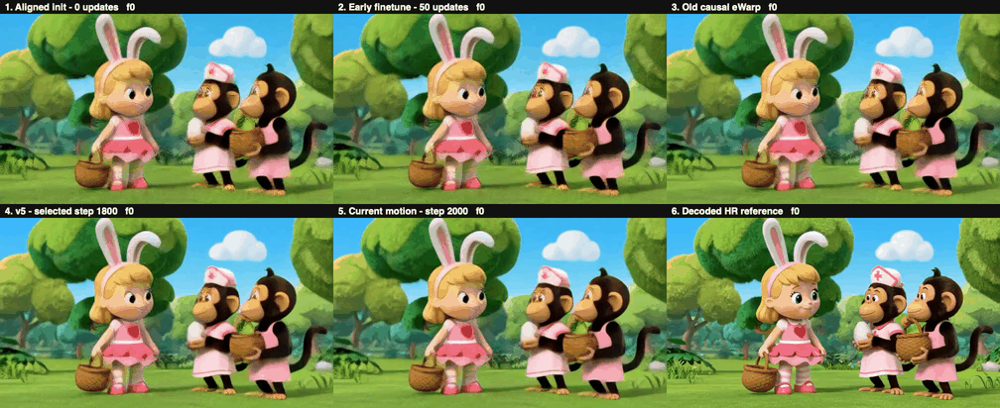

# H3 生产规格纠正与训练准备进度

截至 **2026-11-06 19:48（北京时间）**，新一轮 teacher 目标蒸馏的**正式训练尚未启动，optimizer 更新为 0**。本页记录已经完成的工作、规格纠正与尚待验收的部分；数据准备、静态检查和固定权重诊断均不计为正式训练。

## 当前状态

| 项目 | 已核实状态 |
|---|---|
| 原 v5 / motion 实验 | 已完成；主要视觉伪影仍未解决 |
| 384→768 新数据准备 | 因正式流程规格纠正而主动停止；未进行新训练更新 |
| 正式规格固定权重诊断 | 新 v3 源码审查及本地 CPU 检查通过；本快照尚无实际同规格模型运行结果 |
| 新 teacher 目标蒸馏 | 尚未进行实际 NPU 训练预检或正式更新 |
| 原版权重与六项对比 | 已发布，见下方入口 |

远端只读检查时间为 UTC 11:48:44。本任务的新 teacher trainer/runner 和新720诊断未匹配到活动 Python 进程；这不表示服务器上没有其他人的训练。旧384→768任务于北京时间19:21结束。原日志保留 `failed / Controlled data preparation termination: 15`；这是规格纠正引起的受控停止，不把它改写成模型失败或成功完成。

## 正式输入输出规格

以下形状和最终视频规格由用户明确确认。私有生产输入及调用脚本未公开；诊断替代输入不能声称与私有输入逐元素一致。

| 项目 | 正式规格 |
|---|---|
| LR latent，B/C/T/H/W | `[1,24,67,44,80]` |
| 实际 LR 像素宽×高 | `1280×704`，标称720p |
| HR latent，B/C/T/H/W | `[1,24,67,68,120]` |
| 解码计算宽×高 | `1920×1088` |
| 最终视频 | `1920×1080`，226帧，24fps，约9.4167秒 |
| 空间VAE下采样 | 16倍 |

高度比例为68/44，宽度比例为120/80；不能再套用旧实验的固定2倍限制。诊断拟依据现有上游实现使用1088高解码结果的中心行 `4:1084`，并保留完整226帧；该调用方式与私有生产路径的一致性尚未验证。226帧与67个latent的对应目前只有代码/静态检查证据，实际编码和解码尺寸仍须运行验收。

旧验证使用336×192→672×384，随后准备672×384→1344×768。它们继承自早期小尺寸实验脚本，并非模型只支持2倍，也不是正式720p→1080p流程的验证。将小尺寸验证规格沿用到后续准备是实验配置偏离目标；旧数据、合同和日志保留，旧几何不再作为下一轮正式训练规格。

## 已完成的分辨率诊断

冻结权重诊断已完成4个问题dev的latent阶段（6次编码、10次upscaler前向），以及其中奔马/弹琴两例的像素阶段（14次解码、4条原视频完整120帧/24fps/5秒技术审计）。没有训练。下表统一对共同672×384原始源RGB评价，是两例完整120帧的等权均值：

| 方法 | PSNR↑ | LPIPS↓ |
|---|---:|---:|
| Teacher，192→384 | 25.33410 | 0.1212915 |
| Teacher，384→768 后缩回384 | 29.65625 | 0.0529021 |
| Motion，192→384 | 24.84634 | 0.1249548 |
| Motion，384→768 后缩回384 | 28.39467 | 0.0628516 |
| Teacher，同信息：192先插值到384再超分 | 29.62583 | 0.0777592 |

这些结果显示输入信息量与运行分辨率都值得检查；同信息插值支路也有改善，因此不能把全部变化归因于增加源细节或encoder。不同latent尺寸的MSE不能直接排名。已记录的抽帧观察仍有马腿/地面拖影、琴弦/手重复及脸部细差；完整解码审计不等于全片主观画质通过。

这属于事后、复用的两例问题样本诊断，**不是正式704→1088、226帧流程的效果验证**。完整数值见 [原始摘要的净化副本](evidence/resolution_summary.json)，latent结果见 [latent摘要](evidence/resolution_latent_summary.json)。

## 新规格准备已做到哪里

新v3诊断候选完成10项作者静态检查与16/16项独立本地CPU检查（0跳过），范围为NumPy/stdlib/AST、分块几何与合成错误receipt。它们没有加载实际模型，不能替代真实源视频读取、NPU前向、完整226帧解码或训练恢复检查。源码原SHA为 `1dfc47a50b85fc67119629b9e1be2b3907a890eeaef7ebc97f46010e376ad269`；本进度包收录检查记录，未把候选代码作为已验证的运行版本发布。

诊断替代素材来自已检查的足时长768p视频，拟使用前226个真实帧并裁成1280×704。它们既不是用户私有生产输入，也不是原生1080p真值。现有493例源本身是H3生成的1344×768短视频，不能靠放大变成原生1080p参考，也不能把另一条VIDGEN原片当作与该生成片对齐的HR真值。源审计只覆盖报告注明的范围，不声称所有位置都不存在合适数据。

后续依次需要：真实reader和尺寸检查；同输入teacher/v5/motion固定权重对照与226帧视觉检查；匹配新尺度及时间长度的数据、ROI/tile/flow和teacher缓存；解决原生HR质量守门所需的数据；独立审查及两臂各8步和真实optimizer/RNG恢复预检，之后才进入正式配对训练。teacher输出可以作为蒸馏目标，不能代替原生HR真值并悄悄取消质量守门。

当前候选沿用历史FP32与convHF32设置，而上游wrapper声明bf16；尺寸相同不等于精度/归一化与私有生产流程完全一致。原decoder仍非因果；没有新的Self Forcing、DMD、refiner或decoder训练。旧120帧的监督覆盖与blend分组也不能直接沿用到226帧。

## 已发布结果入口

- [六项同片对比报告](../h3_v5_progress_20261106/README.md)：零更新、50步、旧eWarp、v5、motion、decoded HR参考，另有原双向teacher双栏。
- [完整六格5秒视频](../h3_v5_progress_20261106/media/all_six_0086441.mp4)。这些视频仍属于旧尺寸实验，不是新的226帧正式流程结果。
- [五版推理权重及加载说明](../../weights/h3_v5_20261106/README.md) · [GitHub Release](https://github.com/RedRoman/Tencent-streaming-sr/releases/tag/h3-v5-weights-20261106)。本次没有新训练权重。

原motion在16条复用test上的decodedHR PSNR为25.84846（v5为25.56695），LPIPS为0.128346（v5为0.131721）；ROI和delta小幅改善，但原始latent eWarp对v5退步12.53%、对control退步13.20%，16条对v5全部退步。主要视觉问题未解决，不能用新指标替换旧raw eWarp，也不能把这些数字当新规格效果。

## 证据与版本边界

[当前状态](progress_status.json)、[生产规格](evidence/production_tensor_contract.json)、[独立CPU审查](evidence/diagnostic_v3_independent_review.json)、[源数据审计](evidence/native_hr_source_audit.json)均作为时间点快照保存。[旧纠正记录](evidence/historical_geometry_correction.json)仍保留最初标称720的表述，由本页及最新精确张量规格明确取代，不追改历史记录。

证据中的私有路径与主机标识已参数化。嵌入的SHA仍表示原始运行产物；公开副本SHA另列于 [原始/公开映射](original_public_mapping.json)。本包不包含所引用的全部运行文件、训练缓存或私有输入，不声称它们全部被重新核验。已有历史快照逐项核验见 [历史校验记录](historical_snapshot_verification.json)；本目录自身文件校验见 [manifest](snapshot_manifest.json)。
