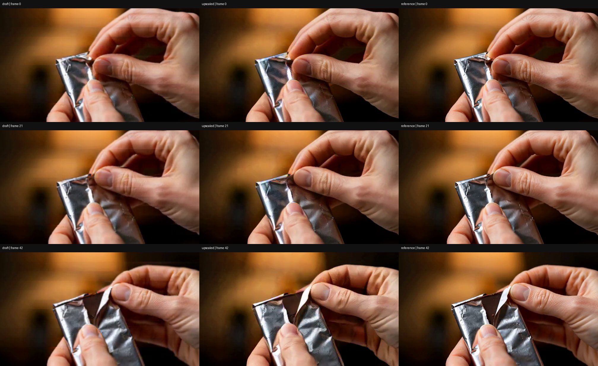
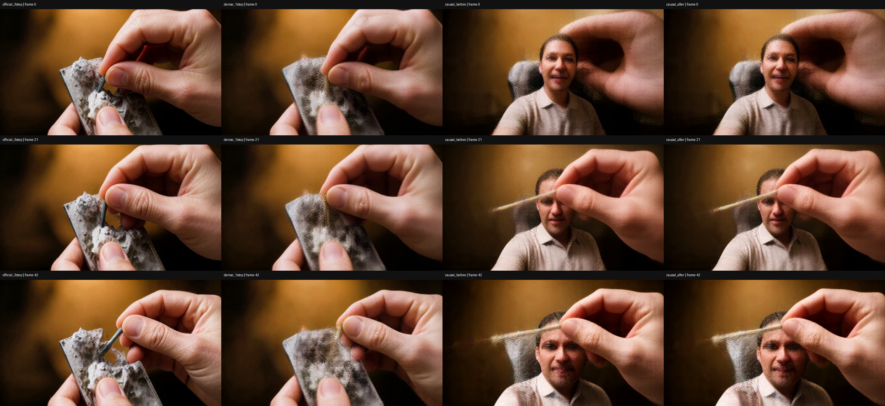
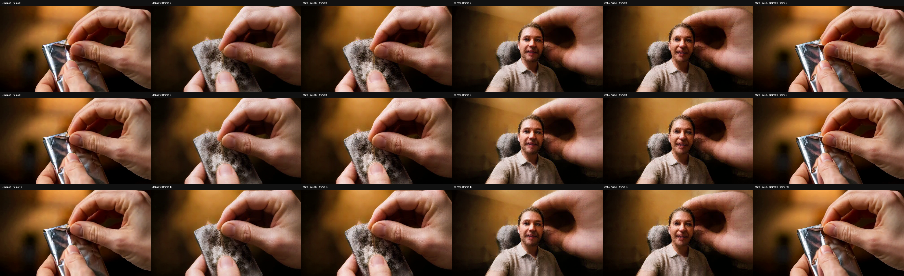

# H3 单步块因果 Self Forcing / DMD：运行证据

实验完成于 2026-11-04。**链路完成，画质未通过。** 代码和复现条件见 [实验目录](../../experiments/h3_refiner_self_forcing_20261104/README.md)。此目录包含可视证据、H.264 视频和 JSON/JSONL 运行记录；不包含权重、checkpoint、latent、原视频全集或完整下载日志。

公开记录对主机标识和用户特定的绝对路径做了脱敏，以 `<EXP_ROOT>`、`<H3_BASE_MODEL>`、`<REDACTED_HOST>` 等占位符代替。数值、时间戳、样本 ID、权重版本、hash 和提示词保留。`train.jsonl` 是训练事件日志，不是数据集 manifest。

## 观测结果

| 检查 | 结果 |
| --- | --- |
| 设备 / 数量 | 2 张 Ascend 910B3；连接信息不公开 |
| 更新 | 6 次 generator、10 次 fake |
| 训练数据 / 留出 | 2 / 1 片段 |
| 输出 | 672×384、43 帧、24 fps |
| 因果单步范围 | 每个 5/5/3 latent 帧块一次模型调用，整段共 3 次 |
| 同噪声重放最大误差 | `0` |
| checkpoint 独立重载最大误差 | `0` |
| rank 0 峰值已分配 NPU 内存 | `39.887 GB` |
| 留出训练前后 latent RMS 变化 | `0.0237404`，不等于画质提升 |
| 画质 | 因果输出训练前和训练后均出现原视频没有的人脸/上半身；没有明确改善 |

### 输入对照

列依次为低分辨率 VAE 草稿、公开 learned latent upscaler 输出、HR reference；行是第 0、21、42 帧。

### refiner 对照

列依次为发布 refiner 的 dense 三步、dense 单步、因果单步训练前、因果单步训练后；行是第 0、21、42 帧。“发布 refiner”指采用其公开权重与 schedule 的本地适配运行，并不表示原仓库的 CUDA pipeline 在此原样执行。

## 视频

视频保留 43 帧、24 fps；四个单独结果视频在发布时从原 MPEG4 Part 2 转为 H.264，内容未重新推理。转换保留默认 metadata 过滤。PNG 对照为原始解码帧拼接。

- [输入 / upscaler / reference 对照](inputs/comparison.h264.mp4)
- [四列 refiner 对照](refiner/comparison.h264.mp4)
- [dense 三步](refiner/official_3step.h264.mp4)
- [dense 单步](refiner/dense_1step.h264.mp4)
- [因果单步：训练前](refiner/causal_before.h264.mp4)
- [因果单步：训练后](refiner/causal_after.h264.mp4)

## 首块消融

新增的 5 个配置使用相同原始样本和噪声，比较 13 / 5 latent 帧前缀、是否禁止静态 text/audio token 读取视频、以及 sigma `0.909375` / `0.3`。视频统一展示前 5 latent 帧解码的 17 像素帧；这里的 `dense13` 等标签表示模型推理使用的前缀长度，不是展示帧数。

左起：upscaled、dense13、static_mask13、dense5、static_mask5、static_mask5_sigma03。

[首块消融视频](causality_ablation/comparison.h264.mp4) · [数值记录](causality_ablation/summary.json)

13 帧两分支没有额外人物；5 帧两分支均出现类似人物；降低 sigma 的 5 帧分支没有该人物并保留锡纸。这削弱了 static mask 是主要原因的初始猜测；短前缀加高噪声与本例偏移更直接相关。全长静音 audio 条件固定，未独立隔离。首块没有历史，因此这里的偏移无需历史误差累积即可发生。原始 `qualitative_review.json` 保留当时未消融的猜测，应结合这组新增证据阅读。

## 文件说明

- `result_summary.json`：完成状态、梯度、重放/重载检查和 latent 诊断。latent 距离及相邻帧差不是感知质量指标。
- `train.jsonl`：实际 2 卡训练的完整事件序列，包括自生成历史、时间块、teacher 冻结抽样检查及独立重载事件。
- `qualitative_review.json`：人工视觉检查结论及尚未被单独检验的假设。
- `inputs/decode.json`、`refiner/decode.json`：解码规范、尺寸、样本 ID、完整提示词和原视频/latent SHA256。
- `asset_sha256_manifest.json`：refiner LoRA、Sharp、latent upscaler、adaln table 的完整 SHA256。
- `bridge_import_status.json`：训练主机取得 refiner/Sharp 后的完整 hash 校验。
- `base_provenance.json`：base 的官方版本与缓存来源检查；明确没有重新对所有 base shard 做完整内容 hash。
- `adapter_structure.json`：下载过程中的只读 shape/header 检查。该早期记录仍写着等待 LoRA 全文件 SHA，随后由资产 manifest 的 `verified` 状态完成验证；除基础设施脱敏外保留该早期记录。
- `fsdp_roles_preflight.json`：小模型双卡更新和冻结检查，不代表全模型画质。
- `full_runtime_preflight.json`：8 卡 base 兼容性检查，明确不是发布 refiner 的结果。
- `snapshot_manifest.json`、`SNAPSHOT_FILES.txt`、`snapshot_audit.json`：本次允许提交的公开文件、字节 SHA256 及基础静态凭证模式检查；不代替上游资产验证。

当前结果不证明 2K、长视频、严格端到端流式推理或收敛质量。upscaler 使用公开社区实现和权重，未进行新的 upscaler 训练/微调。
