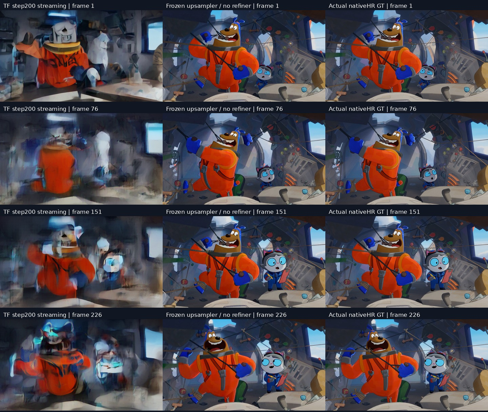

# TF step200 first dev clip: fidelity failure

The first full226 output for `WingIt_dev_3586_3811` fails the frozen fidelity criteria. Compared with the exact frozen upsampler without a refiner, native-HR L1 is **4.621×** and LPIPS is **5.604×**. Both are well above the1.02 limit. These are single-clip results, not the pending three-clip equal-weight aggregate.

| Full226 metric | Step200 streaming | No refiner |
|---|---:|---:|
| Native-HR L1 | 0.09943487 | 0.02152031 |
| Native-HR LPIPS | 0.59713884 | 0.10655534 |
| PSNR dB | 16.8654 | 27.7283 |
| Temporal delta L1 | 0.03928526 | 0.01659604 |

Sampled-frame inspection at frames0,75,150,225 shows severe changes to character shapes and scene details, with ghosting and blur. The head/face geometry already differs strongly at frame0. This is enough to reject this checkpoint under the no-structural-drift rule; it is **not** a completed continuous-motion review. The full video remains a retained negative result, not an accepted model demonstration.

All226 frames were decoded at1920×1088 and cropped y=4:1084 to1920×1080. The provisional official overlap VAE was used for this quality comparison; strict per-latent VAE validation remains pending. The explicit no-text/known-silence engineering conditioning and two-clip TF training limitations are unchanged. No quality threshold was relaxed and no test data were used.

The refiner's full67 incremental-cache correctness result remains valid within its measured scope; it does not imply output fidelity. No self-generated-history or DMD promotion is permitted from this failed checkpoint. The original dense reference and remaining frozen checkpoint/dev evaluations still need completion.

[Play/download the full226 comparison preview](step200_comparison_quickview.mp4). Left: TF step200 streaming; middle: exact frozen upsampler without a refiner; right: actual native-HR GT. This1440×310 H.264 viewing copy retains all226 timestamps at24fps; measurements use the original lossless1080p RGB. Technical video checks passed; continuous visual review remains pending.

The subsequent original dense-reference preflight failed before full inference: max absolute error0.2541511, relative RMS0.01785255 against the unmodified upstream orchestration, versus frozen limits0.03/0.005. No original-dense full video exists yet. The owned batch stopped and reaped its child, retaining this implementation-parity failure for diagnosis. It is not evidence about the original model’s output quality.
