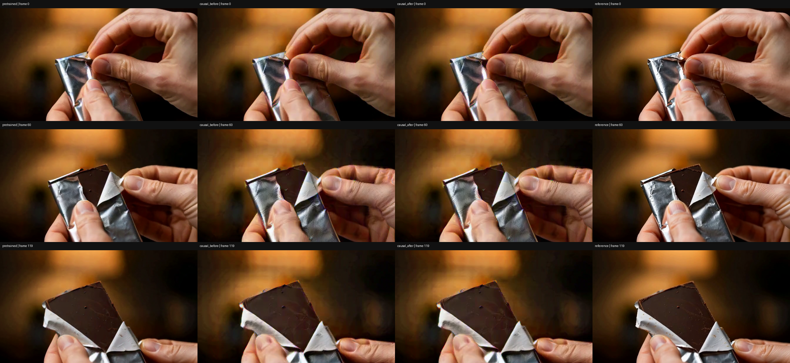
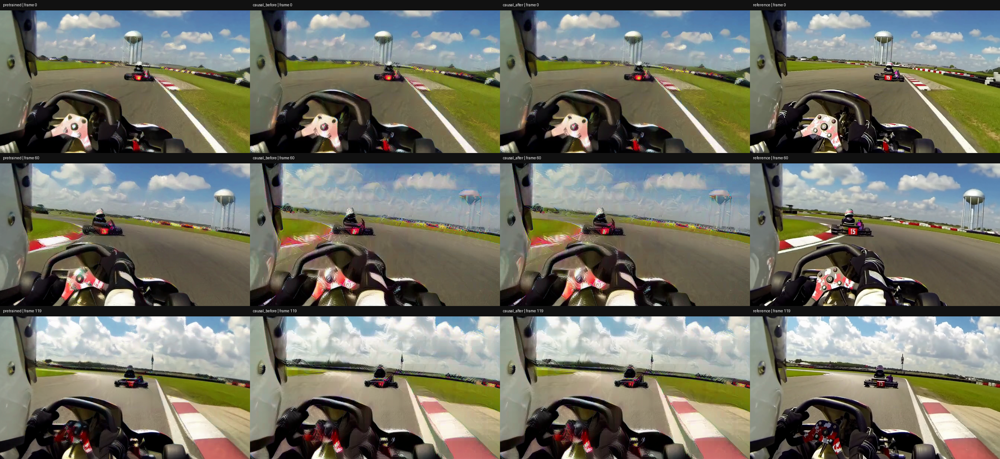

# 因果 upscaler：完整 5 秒视频对照

将上一轮 43 帧（约 1.79 秒）的评估改为 **120 帧、24 fps、5.000 秒**。复用同三条源视频与同一组权重：发布的非因果 upscaler、aligned 因果初始化、已完成 50 步的因果微调模型。**本轮没有新增训练，也不加载 H3 refiner。** [代码与复现入口](../../experiments/h3_upscaler_5s_20261104/README.md)。

## 视频

四列顺序：**原版非因果 → 因果微调前 → 因果微调后 → 配对 HR 参考**。单列分辨率 672×384，四列视频额外含标题。所有单列与对照视频均有 120 帧，原速 24 fps，H.264 编码。

| 片段 | 四列对照 | 单列输出 |
| --- | --- | --- |
| VIDGEN5S_0336361 | [5 秒四列对照](VIDGEN5S_0336361/comparison.h264.mp4) | [5 秒微调后单独输出](VIDGEN5S_0336361/causal_after.h264.mp4) |
| VIDGEN5S_0515402 | [5 秒四列对照](VIDGEN5S_0515402/comparison.h264.mp4) | [5 秒微调后单独输出](VIDGEN5S_0515402/causal_after.h264.mp4) |
| VIDGEN5S_0380588 | [5 秒四列对照](VIDGEN5S_0380588/comparison.h264.mp4) | [5 秒微调后单独输出](VIDGEN5S_0380588/causal_after.h264.mp4) |

PNG 为第 0、60、119 帧，视频包含中间全部帧。抽帧观察不等于完整动态或感知评估。

## 真实时长与 VAE 时间处理

三个源文件在 24 fps 下都具有 124 帧。本轮严格读取前 120 个源视频帧；FFmpeg 读取未使用外部 `tpad`、循环、慢放或末帧保持，所用 reader 的 FPS 重复帧计数均为 0。源 SHA256、完整源帧数及读取证明保存在 [source_proof](source_proof/)，配对几何保存在 [pair_summary.json](pair_summary.json)。

H3 VAE 自身仍有官方的内部末帧补齐：

`120 真实输入帧 → VAE 内部补 16 帧到 136 → 37 个 latent 帧 → 解码 124 帧 → 裁掉尾部 4 帧 → 输出 120 帧`

这层内部 padding 单独记录，不把它当作真实源帧，也不通过降低帧率延长旧 43 帧视频。LR 和 HR 都从相同 120 帧内容编码；输出尺寸与前轮保持一致，输入 latent `[24,37,12,21]`，输出 `[24,37,24,42]`。

## 本轮评估

PSNR 相对同一固定 FP32 VAE 解码的配对 HR reference，在视频压缩前的 uint8 RGB 上计算；越高越好：

| 片段 | 继承划分 | 原版非因果 | 因果微调前 | 因果微调后 |
| --- | --- | ---: | ---: | ---: |
| VIDGEN5S_0336361 | train | 23.869 | 20.793 | 20.991 |
| VIDGEN5S_0515402 | train | 22.825 | 19.664 | 19.691 |
| VIDGEN5S_0380588 | holdout | 30.112 | 25.255 | 25.314 |

本轮三个片段微调后 PSNR 都略高于因果初始化；开发留出片段提升 0.059 dB，仍比原版低 4.798 dB。首、中、尾抽帧中，因果版本在手部运动和赛车运动区域仍有明显重影、边缘彩色伪影；50 步微调没有消除这些问题。

完整 latent 指标、像素 PSNR、时间差分误差、源 RGB 次要对照及 checkpoint 哈希见 [summary.json](summary.json)。新视频使用更长的 VAE 编码上下文与不同形状的 posterior 噪声采样，前 13 个 latent 不保证与上一轮一致；因此不能把新旧分数变化全部归因于时长。本轮各版本共享同一组 37 帧配对 latent，内部对照有效。

因果微调前、后两个模型，在全部三个片段上分别检查：

- cut `1/13/25` 之后替换未来输入，比较过去输出；
- 独立长度 `1/13/25` 的前缀与完整长度 37 的共同输出；
- `[5,5,5,5,5,5,5,2]`、37 个单帧、`[7,13,17]` 三种缓存分块与整段输出；每次分块前重置缓存，最终处理计数为 37。

合计 **54 项检查全部通过，最大绝对差为 0**，阈值仍为 `1e-4`。原 50 步 checkpoint 的 SHA256 已与原训练报告核对，重新安装因果算子时没有再次移位权重。

## 解释边界

- 这是对已有权重的 5 秒长度扩展评估；微调模型此前只在 13-latent-frame 片段上训练，不应称为已经完成 5 秒重训练。
- 使用的是原来的两个训练源片段及一个开发留出源片段，并非新的盲测数据集。
- 这里检查 upscaler 相对于固定 latent 输入的因果性。实际 VAE 编码器采用因果卷积和逐帧归一化，但 VAE **解码器仍非因果**；整条像素 pipeline 的因果性未验证。
- 37 帧仍短于 upscaler 结构的最长 149 帧感受野，未验证长流稳态、2K 或端到端实时性能。
- 发布代码、脱敏数值报告、抽帧图和六段 5 秒视频；不包含权重、latent 缓存或原始源视频。
