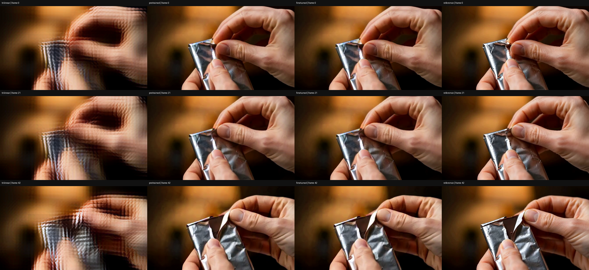

# Open-H3 latent upscaler: 20-update adaptation trial

We verified that the released LBH 345,280,216-parameter upscaler can be fine-tuned end-to-end on Ascend, then compared its decoded output with interpolation and the released checkpoint. The modest latent-error reduction did **not** translate into a substantial visual improvement in this tiny trial. The released model is a useful starting point; retraining from scratch is not justified by these results.

## Scope and validation

- Three videos: two for training and one held out within this experiment. Source data itself comes from a pre-existing training manifest. No held-out gradient updates or checkpoint selection.
- Exact paired geometry: common first 64 HR source frames, 672×384; LR is a rounded 2×2 pixel average to 336×192. Both resolutions use the same FP32 H3 VAE context and seed 42 posterior sampling, then keep the first 13 latent frames (43 decoded frames). Different latent shapes mean the sampled LR/HR posterior noise is not spatially paired.
- Train the released upscaler only, preserving Open-H3 `D(U(N(z)))`, the scale 2 conditioning and full-clip architecture. No diffusion refiner in this comparison. AdamW 1e-6, 20 updates, latent MSE + 0.1 temporal-difference MSE. This is our objective, not the author's unpublished training recipe.
- Released-node forward parity max abs 0; all 322 parameter tensors receive finite gradients; sampled parameters change; independently constructed checkpoint reload output max abs 0. Training and optimizer checkpoint are retained externally.
- FP32 parameters loaded from released BF16 storage. One Ascend 910B3, peak allocated 5.27 GiB. The complete train/baseline/save/reload stage took 45.73 s; VAE pair preparation and decoding are excluded. This is not a 2K benchmark.

## Pixel results

PSNR in dB, higher is better. Target: matched HR latent decoded by the same VAE. Metrics use uint8 RGB before MP4 compression. Source-RGB PSNR is also recorded in `pixel_metrics.json`, but includes VAE reconstruction/alignment error.

| Sample | Trilinear | Released upscaler | After 20 updates | Change vs released |
| --- | ---: | ---: | ---: | ---: |
| VIDGEN5S_0336361 (train) | 15.7345 | 20.9296 | 21.0121 | +0.0826 |
| VIDGEN5S_0515402 (train) | 16.2328 | 22.7702 | 22.7901 | +0.0198 |
| VIDGEN5S_0380588 (holdout) | 18.1919 | 28.8042 | 28.8557 | +0.0514 |

On the held-out chocolate/foil clip, latent MSE falls from 0.07114708 to 0.06828142 (4.03%), while pixel PSNR rises by only 0.05145 dB. Pixel temporal-difference MSE falls from 0.00079395 to 0.00077900; this is a reconstruction metric, not a perceptual smoothness assessment.

Visual inspection of first/middle/last frames for all three clips shows strong ghosting from direct latent interpolation. The released and fine-tuned outputs look very similar; both remain softer than the HR reconstruction, with some structural distortion in the moving kart clip. In the inspected chocolate/foil frames both preserve the hands and wrapper without the additional person seen in the prior refiner experiment. This does not establish performance on unseen content, generated draft latents, full streaming rollouts, or 2K.

## Videos

Columns are **trilinear → released → fine-tuned → HR VAE reconstruction**. All videos have 43 frames at approximately 24 fps. H.264 copies are provided for playback; the quantitative metrics were computed before encoding/transcoding.

- [Held-out chocolate/foil comparison](VIDGEN5S_0380588/comparison.h264.mp4)
- [Training pasta comparison](VIDGEN5S_0336361/comparison.h264.mp4)
- [Training kart comparison](VIDGEN5S_0515402/comparison.h264.mp4)
- Held-out individual videos: [trilinear](VIDGEN5S_0380588/trilinear.h264.mp4), [released](VIDGEN5S_0380588/pretrained.h264.mp4), [fine-tuned](VIDGEN5S_0380588/finetuned.h264.mp4), [reference](VIDGEN5S_0380588/reference.h264.mp4).

## What remains

The released upscaler is noncausal: symmetric temporal convolutions and clip-wide GroupNorm read future information. Block splitting alone is not an equivalent causal conversion. A streaming version needs causal temporal convolutions and normalization that does not use future frames, followed by adaptation/distillation and a future-perturbation invariance check. This trial preserves the released architecture and does not solve causality.

For quality, the next meaningful comparison requires more training/held-out clips, generated-draft inputs and decoded-image objectives. A lower latent MSE alone is insufficient evidence of better fine detail.

[Portable code and reproduction](../../experiments/h3_upscaler_trial_20261104/README.md). Exact metrics/provenance are in `summary.json`, `steps.jsonl`, `pair_summary.json`, and `pixel_metrics.json`. Runtime and source paths are replaced with environment placeholders; numeric evidence and asset hashes are preserved. Weights, source datasets and latent caches are excluded.
