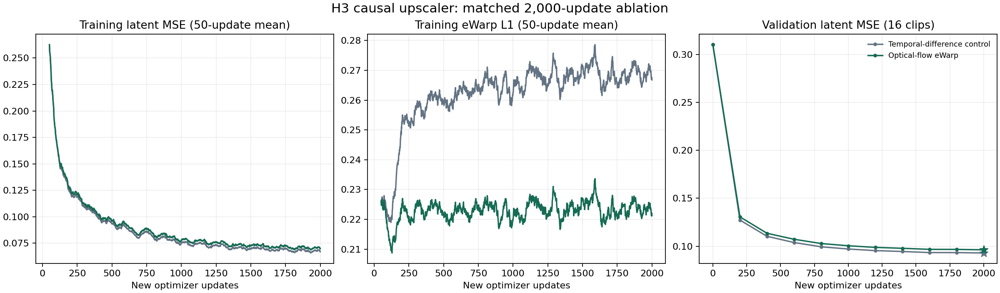
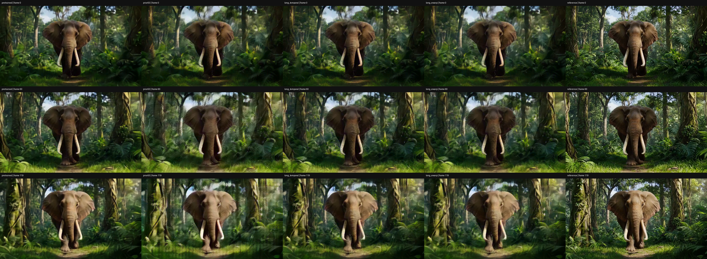
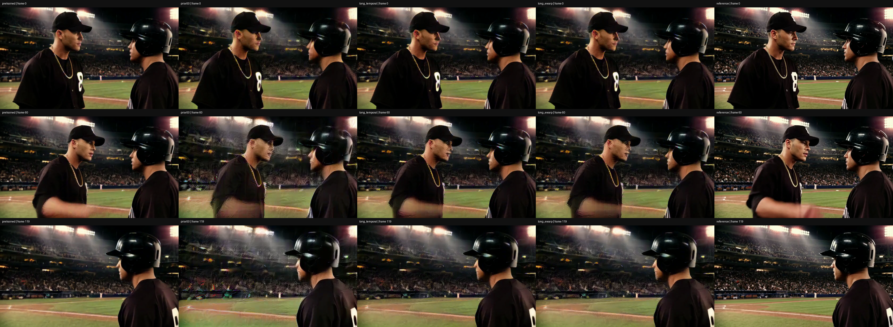
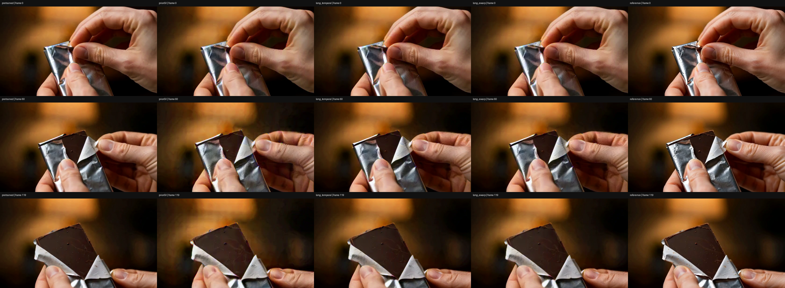

# H3 因果 upscaler：扩大训练与 eWarp 对照结果

两组各 2000 次更新已完成，eWarp / temporal 对照实际训练分别为 **43.64 / 43.43 分钟**（含训练中验证与保存，数据准备和最终解码另计）。相比先前仅 50 步、30.80 秒的流程试跑，这次扩大到 128 条训练视频，并使用完整 5 秒片段。[代码与方法](../../experiments/h3_upscaler_ultraflash_20261104/README.md)。这是在现有 H3 因果 Conv3d upscaler 上采用 MSE + eWarp 思路的实验，不是 Ultra Flash CMN 架构或官方完整训练配方复现。

固定 128 train / 16 dev / 16 test，旧三条另列 legacy；14 条历史异常全部排除新划分，源 SHA 去重。两组从同一 prior50 权重开始，用新 AdamW、FP32、batch 1、梯度裁剪 1、学习率峰值 1e-5、100 步 warmup 后余弦趋向 1e-6，各增加 2000 次更新。实验为 MSE + 0.1 eWarp L1，对照为 MSE + 0.1 时间差分 MSE；每 200 步以 dev 平均 latent MSE 选模（含 step0），结束后评估 test。

光流为固定 GT RGB 四分之一分辨率上的 Farneback backward flow，使用 in-bounds mask，不做遮挡检测。这些是本地选择。120 真实源帧经 VAE 内部补齐到 136 帧，编码 37 latent，解码 124 帧后裁成 120 帧/24 fps/5 秒；重建损失覆盖 36 个真实锚点，warp 覆盖 35 对有效相邻锚点。没有 refiner/DMD/Self Forcing 或 VAE 梯度。

## 训练和 latent 指标

| 训练组 | 新增更新 | dev 选中的 step | 最佳 dev latent MSE |
| --- | ---: | ---: | ---: |
| ewarp | 2000 | 2000 | 0.096323 |
| temporal | 2000 | 2000 | 0.093005 |

下表按片段等权平均，test 与 legacy 分开；MSE 越低越好。

| 划分 | pretrained | prior50 | long_temporal | long_ewarp |
| --- | ---: | ---: | ---: | ---: |
| test | 0.075321 | 0.292029 | 0.091238 | 0.094213 |
| legacy | 0.094232 | 0.286431 | 0.093041 | 0.095610 |

16 条独立 test 上的共同指标如下，按片段等权平均：

| 模型 | latent MSE ↓ | eWarp L1 ↓ |
| --- | ---: | ---: |
| 原版非因果 pretrained | 0.075321 | 0.279686 |
| 因果 prior50 | 0.292029 | 0.230582 |
| 长训练 temporal | 0.091238 | 0.270156 |
| 长训练 eWarp | 0.094213 | 0.225486 |

**结论：扩大训练显著降低了因果版本的重建误差；eWarp 引入了指标取舍。** 相对同预算 temporal，eWarp 的 eWarp L1 降低 **16.535%**，MSE 增加 **3.261%**，16 条 test 的方向全部一致。相对 prior50，eWarp 的 MSE 降低 **67.74%**，eWarp L1 仅降低 **2.21%**；不能把前述 16.535% 写成相对初始化的改善。两种长训练与原版非因果模型仍有重建差距。两组最佳点均在第 2000 步，最后 200 步 dev MSE 仍改善约 0.43%–0.44%，只能说明边际改善减小，不能证明充分收敛。

三条固定新 test 展示例的平均 PSNR：pretrained **24.338 dB**、prior50 **20.939 dB**、temporal **22.609 dB**、eWarp **22.373 dB**。旧巧克力 legacy holdout 分别为 **30.112 / 25.314 / 28.005 / 27.564 dB**。这些是 3 条新例与 1 条 legacy 的像素结果，不能代表完整 16 条 test 的像素均值。

## 四条固定展示视频

选择规则在看分数前固定：test animal/daily/sport 各按 ID 取第一条，再加旧 legacy holdout。五列顺序为原版非因果 → prior50 → temporal 长训练 → eWarp 长训练 → decoded HR reference。下面八段视频均为 H.264、120 帧、24 fps、5 秒，并由 AVAssetReader 完整解码验证全部 120 帧、逐帧时间戳和正常结束；[解码证据](video_decode_evidence.json) 的 SHA256 对应本次发布文件。不能把四条展示结果代表为完整 test 像素评估。

| 片段 | 五列视频 | 单列视频 |
| --- | --- | --- |
| VIDGEN5S_0128747 | [五列对照](VIDGEN5S_0128747/comparison.h264.mp4) | [eWarp 输出](VIDGEN5S_0128747/long_ewarp.h264.mp4) |
| VIDGEN5S_0086441 | [五列对照](VIDGEN5S_0086441/comparison.h264.mp4) | [eWarp 输出](VIDGEN5S_0086441/long_ewarp.h264.mp4) |
| VIDGEN5S_0829322 | [五列对照](VIDGEN5S_0829322/comparison.h264.mp4) | [eWarp 输出](VIDGEN5S_0829322/long_ewarp.h264.mp4) |
| VIDGEN5S_0380588 | [五列对照](VIDGEN5S_0380588/comparison.h264.mp4) | [eWarp 输出](VIDGEN5S_0380588/long_ewarp.h264.mp4) |

PSNR 相对同一 HR latent 解码结果，在视频压缩前的 RGB 上计算；源 RGB 的次要指标保留在 [evaluation/summary.json](evaluation/summary.json)。

| 片段 | pretrained | prior50 | long_temporal | long_ewarp |
| --- | ---: | ---: | ---: | ---: |
| VIDGEN5S_0128747 | 21.659 | 19.690 | 20.597 | 20.501 |
| VIDGEN5S_0086441 | 25.482 | 21.139 | 23.342 | 23.067 |
| VIDGEN5S_0829322 | 25.874 | 21.988 | 23.888 | 23.552 |
| VIDGEN5S_0380588 | 30.112 | 25.314 | 28.005 | 27.564 |

抽帧检查覆盖每条视频的第 0、60、119 帧。相较 prior50，两种长训练减轻了部分树叶/看台拉丝、彩色杂边和人物轮廓重影；动画人物的眼睛、帽子符号和身体边缘仍有明显伪影，巧克力包装和手指细节也与 reference 有差距。eWarp 与 temporal 的静态观感很接近，未见可靠的全面优胜或明确额外整体模糊。这是抽帧观察，不声称已完成整片动态观感评价，不能仅凭 eWarp 分数宣称闪烁更少。

## 验证范围与证据

因果检查 **108 项 = 4 视频 × 3 因果模型 × 9 项**，均通过，最大绝对差 `0`。独立重载检查为 **2 个长训练模型 × 19 个 test/legacy**，均通过，最大绝对差 `0`，阈值均为 `1e-4`。因果性仅指 upscaler 对固定 latent 的依赖；VAE decoder 非因果，未验证整条像素 pipeline 的严格因果性。37 latent 仍短于结构最长 149 帧感受野。

训练 config/summary/steps 位于两组训练目录，配对计划、READY、四份 split manifest 和分片摘要在 [pairs](pairs/)，最终像素分片与 completion 证明在 [evaluation](evaluation/)，并保留解码前 latent summary 的原始内容及源文件指纹，用于核对解码输入。一个解码分片曾在运行前因设备已被占用退出，随后转移到已空闲设备完成；两组训练未中断。数据来自生成视频，未去除语义近重复；legacy 不是新的盲测。恢复路径保存 optimizer/RNG/contract，但未声称 bitwise resume 已验证。

**哈希约定：** JSON/JSONL 中已有的 `plan_sha256`、manifest/checkpoint/source SHA 都保留源 run 的含义。脱敏会改变公开文件字节，不能用脱敏 plan 的哈希去冒充训练 plan 哈希。[source_fingerprints.json](source_fingerprints.json) 对照原始下载文件 SHA 与公开文件 SHA；[snapshot_manifest.json](snapshot_manifest.json) 校验本次公开文件本身（不包含自身哈希）。权重、paired tensors、flow tensors 和原始源视频不在发布包中，对其 SHA 只保留记录，不声称打包器重新验证了这些未下载文件。
