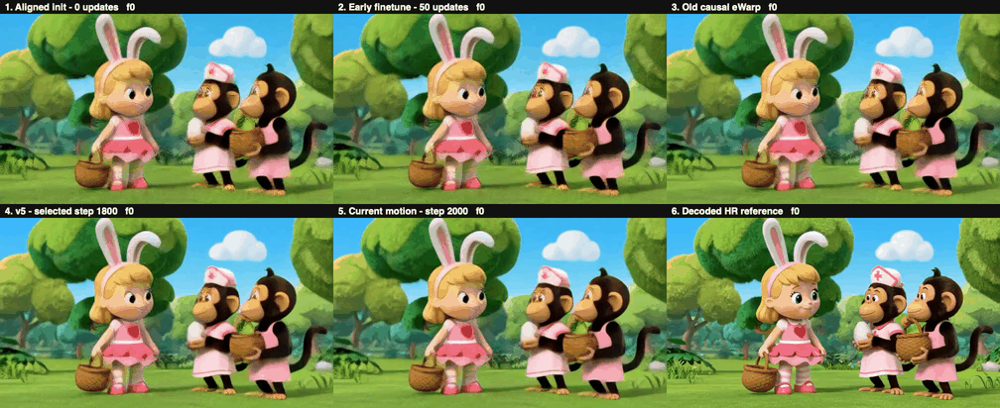
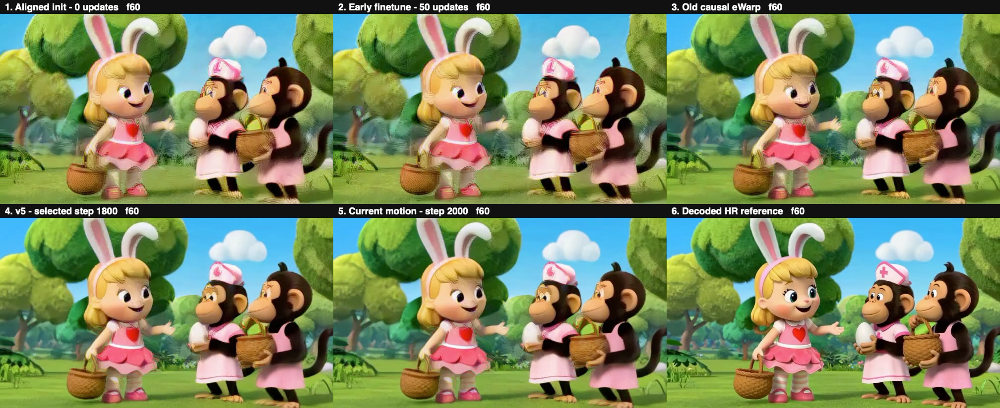
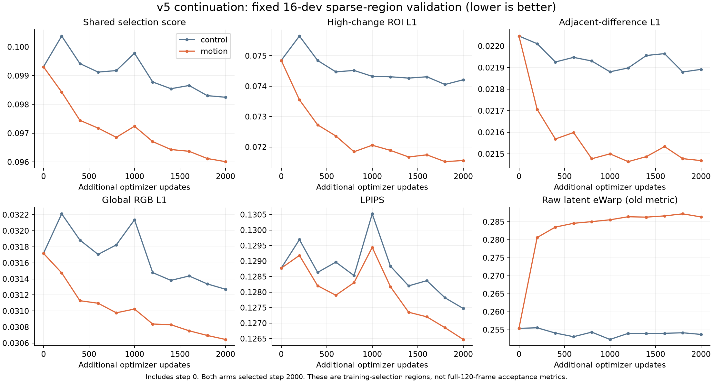
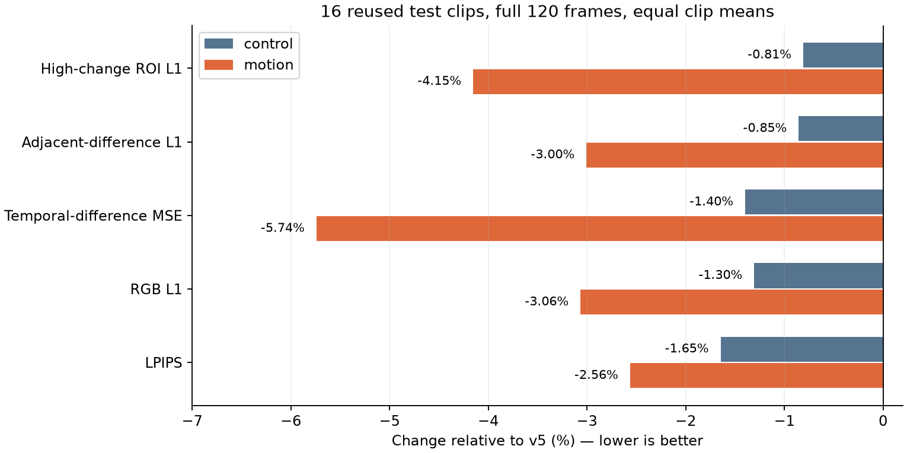

# H3 v5：六项同片对比与伪影诊断进展

**结论：本轮 motion loss 训练与评估已结束。指标小幅改善，主要视觉问题未解决，不推荐作为“已解决伪影”的升级版。** 本页是 2026-11-06 的进度快照；完整批量媒体和本地权重归档仍未完成，不影响下方五条已校验视频的发布。v5 的固定版本身份不变。

## 先看用户指定动画：六项对比

**[打开完整六格视频：120 帧 · 24 fps · 5 秒 · H.264](media/all_six_0086441.mp4)**。下面为覆盖完整 5 秒的低帧率缩小预览，判断细节请打开原 MP4；GIF 不参与指标计算。

| 上排左：① 零更新因果改造 | 上排中：② 早期 50 步 | 上排右：③ 旧 causal eWarp |
|---|---|---|
| 下排左：④ v5 | 下排中：⑤ 当前 motion | 下排右：⑥ decoded HR reference |

片段 **VIDGEN5S_0086441**，即兔耳女孩与两只穿粉色衣服的猴子。每格原生 672×384；六格视频 2016×824，包括标签。第 60 帧原尺寸静态图：

| 项目 | 权重 / 训练历史 | 该选定权重自因果改造以来累计更新 |
|---|---|---:|
| ① 零更新 aligned | 历史 initial_model，因果左填充、权重转换、逐帧 GroupNorm；本次补算，没有训练 | 0 |
| ② early50 | 同架构早期微调 50 步 | 50 |
| ③ old eWarp | early50 后增加 2000 步 latent MSE + raw eWarp | 2050 |
| ④ v5 | old eWarp 后完成 2000 步 hybrid，dev 选择 step1800 | 3850 |
| ⑤ motion | 从 v5 所选权重继续 2000 步，dev 选择 step2000 | 5850 |
| ⑥ decoded HR reference | 冻结 VAE 解码 HR latent，作为参考；不是上采样模型输出，也不是原始 RGB | — |

五个模型版本均为同一 345,280,216 参数 Conv3d 架构，历史训练预算不同；这张六格不是等算力架构消融。control 与 motion 才是从相同 v5 初始化出发的本轮等预算损失对照。

### 四条近距离双栏（同片、同帧，各 5 秒）

- [① 零更新因果改造 vs ⑤ motion](media/zero_aligned_vs_motion_0086441.mp4)
- [② 早期 50 步 vs ⑤ motion](media/early50_vs_motion_0086441.mp4)
- [③ 旧 causal eWarp vs ⑤ motion](media/old_ewarp_vs_motion_0086441.mp4)
- [额外对照：原版双向 teacher vs ⑤ motion](media/original_teacher_vs_motion_0086441.mp4)

**原版双向 teacher 不是“零更新因果版”。** 此处 teacher 仅为原版 upscaler + 同一冻结 decoder，不含后续 diffusion refiner。

实际查看六格的 0、17、60、90、119 帧，以及早期版和 teacher 双栏帧：早期版本已经存在重复细线、眼部/手部/篮子轮廓错形；v5/motion 更平滑，主要形变仍然明显，motion 与 v5 很接近。观察支持“训练改变并平滑纹理，主要形变未解决”，不能据此断言“未训练版本本来完全干净，所有伪影均由微调产生”。全片技术解码通过不等于每帧主观画质通过。

零更新版使用历史已转换权重原样加载，没有第二次转换。本次重新解码的全部 120 帧参考与旧缓存逐像素相等（max abs = 0）；其余版本复用既有输出，来源与 SHA 在本快照证据中记录。该片已被反复查看，属于事后诊断，不是盲测，也不用来重选 checkpoint。

## 已完成的 motion 实验

control / motion 均从固定 v5 初始化，同 seed、数据、样本、区域、LPIPS 帧、学习率与 2000 次连续更新；两臂均从包含 step0 的 dev 候选中选到 step2000。冻结 decoder / LPIPS 不更新。control 保留原 raw eWarp；motion 改为 GT-residual eWarp，加 0.5×高变化 ROI RGB L1 和 0.2×相邻 RGB 差分残差。训练仍只有 90/120 个非混合帧可采样，30 个混合帧没有被直接监督。

16dev 全片 gate 通过后完成 16test + 3legacy；三组独立统计，每片 120 帧，175 个原始 MP4 全片技术审计通过。下表为 **16test 等权均值**，像素参考是 frozen VAE decoded HR，不能与 source RGB 指标混用：

| 版本 | PSNR ↑ (dB) | LPIPS ↓ | 高变化 ROI L1 ↓ | 相邻差分 L1 ↓ | 原始 latent eWarp ↓ |
|---|---:|---:|---:|---:|---:|
| v5 | 25.566953 | 0.131721 | 0.078091 | 0.018586 | 0.245695 |
| control | 25.654085 | 0.129554 | 0.077460 | 0.018427 | 0.244241 |
| motion | 25.848464 | 0.128346 | 0.074849 | 0.018027 | **0.276485** |

motion 相对 v5：PSNR +0.2815 dB、LPIPS −2.56%、ROI −4.15%、delta −3.00%；**raw latent eWarp +12.53%，全部 16 条退步**。相对 control 的 raw eWarp +13.20%，也是 16/16 退步。residual eWarp 是另一个指标，不能替代原指标来宣称时序质量全面提升。

LPIPS 退步片：对 v5 为 `VIDGEN5S_0864318`；对 control 为 `0086441 / 0100402 / 0128747 / 0864318`（均带 `VIDGEN5S_` 前缀）。PSNR、ROI 与 delta 在 16test 对两基线均改善，但用户反馈和实看都没有确认主要视觉问题解决。

## 诊断已证明什么、还没有证明什么

| 诊断 | 已完成范围 | 观察与解释边界 |
|---|---|---|
| 输入时间偏移 | 8 个问题片，latent offset −6…6 | 全部最优 offset=0；只排除统一整段偏移，不能排除其他时序问题 |
| 因果改造因子 | 4 个问题 dev，16 次原权重 forward + 8 个既有 v5/motion 输出；只测 latent | 零更新卷积改造损伤大；GN-only、Convs-only 均非因果诊断分支，不可作为流式模型 |
| 低清 VAE 往返 | 奔马 / 弹琴两个 dev，只做冻结 VAE decode，不经过 upscaler | 低清 VAE 往返本身出现腿部 / 面部形变；输入链确有损伤来源，但未证明 encoder 单独负责，也不能解释全部训练前后质感变化 |
| 同片全版本 | 上述动画 5 个历史模型 + HR 参考、另加双向 teacher | 早期已有伪影，训练改变质感；主要错形仍在 |
| 更高分辨率 / 保持信息量的尺寸对照 | v2 草稿与结构预检已准备 | **尚未上传或执行，没有结果** |

改造因子 mean latent MSE（参考 HR latent，四个 dev）：teacher **0.084946**、GN-only **0.111403**、Convs-only **0.443635**、both-initial **0.421700**、v5 **0.098325**、motion **0.096734**。卷积因子包含权重截断/重排及左填充的整体改动，不能只归因 padding；这组没有新 pixel decode，不能把 latent 排名直接当作视觉根因。四条 fresh teacher 与旧缓存逐元素相同。

低清 VAE 探针的公共参考为 **source RGB 672×384**，与上表参考不同：

| 片段 | raw LR bicubic PSNR | LR VAE roundtrip 后 bicubic | HR384 VAE roundtrip |
|---|---:|---:|---:|
| 奔马 0421364 | 36.4089 | 27.0974 | 33.5614 |
| 弹琴 0665341 | 34.0413 | 26.8726 | 33.5275 |

[奔马局部对照](media/lr_probe_detail_VIDGEN5S_0421364.jpg) · [弹琴局部对照](media/lr_probe_detail_VIDGEN5S_0665341.jpg)。

这些是两条事后 dev 探针，不是动画片的直接根因实验，也没有 LPIPS 结果。更高尺寸分支计划使用真实 1344×768 源，并加入“192 先 bicubic 到384再编码”的控制分支，区分工作尺寸与输入信息量；尚未运行。

## 后续方向（未训练、未验证）

1. 完成固定权重的输入分辨率与 VAE 链诊断，先确认输入信息在哪一环损失。
2. 以贴近同输入 teacher 为明确目标，做等预算 teacher-target 蒸馏：teacher latent + 经同一冻结 decoder 得到的 teacher RGB / LPIPS，保留 HR 质量 guard。当前训练主要用 HR 目标，不能默认等价于保留 teacher 质感。
3. 在恢复全局质感后，测试仅使用当前 / 过去帧的运动对齐与可靠性门控，减少遮挡、新显露区域错误历史的干扰；必要时再测试逐步因果化与更保守初始化。

当前是确定性 Conv3d upscaler，没有生成输出递归反馈的训练链，暂不把 Self Forcing / DMD 作为首选修复。Self Forcing 面向自回归生成的训练/推理分布差异；DMD 还需要扩散 score teacher 等机制，不能直接把此 Conv3d teacher 当作 DMD teacher。后续流式扩散 refiner 可另行研究，不能保证单靠 DMD 保留同输入 teacher 的细节。参考：[Self Forcing](https://arxiv.org/abs/2506.08009)、[DMD](https://arxiv.org/abs/2311.18828)。以上仅是后续方案，本次没有新增训练。

## 因果性和交付边界

- 仅验证固定输入 latent → upscaled latent 的因果性；原 H3 decoder 仍非因果，不能声称端到端流式。两臂各有 36 项实际尺寸检查与独立 16 项 HF32off 长序列检查。
- train/eval 的 conv HF32=true、matmul=false。既有 163latent、2×2 小空间在默认 HF32 下 stream/full 最大差 0.00112772 的边界保留；关闭 HF32 的独立通过不代表默认模式任意尺寸通过。
- 本轮没有 DMD / Self Forcing / refiner / decoder 训练。test 复用，诊断是 post-hoc，不是新盲测；严格因果模型也无法对所有输入完全复现会看未来的双向 teacher。
- 此快照发布五段选定对比视频、预览、完整指标摘要与诊断证据。其余批量媒体和本地 checkpoint 下载尚未完成；下载失败证据保留，不冒充全量交付。权重和训练缓存不进 GitHub。
- 原始 JSON / 源码 SHA 与脱敏公开副本 SHA 分开记录，嵌入的执行合同 SHA 不回填为公开 SHA；历史 preflight / v5 / Conv3d / test16 快照保持原字节。

原始训练代码入口：[等预算 motion 实验历史预检快照](../../experiments/h3_v5_motion_20261106/README.md)。历史快照中的“运行中”描述是当时状态；以本页的完成情况和局限为当前进展。

## 可核查证据

- [完整评价 summary（含 dev / test / legacy 与逐片、prefix / tail / blend 分组）](evidence/evaluation/summary.json)、[16test 与 legacy 明细](evidence/evaluation/test_summary.json)
- [两臂训练配对审计](evidence/paired_training_audit.json)、[独立审计](evidence/analysis/independent_audit.json)
- [五视频120帧审计](evidence/analysis/version_comparison_20261106/cartoon_0086441/all_videos_decode_audit.json)、[六项来源与checkpoint身份](evidence/analysis/version_comparison_20261106/cartoon_0086441/source_identity_completed.json)、[同片视觉记录](evidence/analysis/version_comparison_20261106/cartoon_0086441/visual_review.md)
- [转换因子 latent 结果](evidence/diagnostics/conversion_factors_v1/latent_summary.json)、[低清 VAE 探针](evidence/diagnostics/lr_roundtrip_v1/summary.json)、[时间偏移扫描](evidence/diagnostics/temporal_alignment_v1.json)
- [诊断源码与未执行草稿](code/README.md)、[原始 / 公开 SHA 映射](original_public_mapping.json)、[本快照状态](progress_status.json)

JSON 内的路径占位符用于隐去环境位置；原始运行 SHA 仍描述原始字节。公开副本需要按映射核验，不能用公开副本 SHA 替换历史执行合同。
